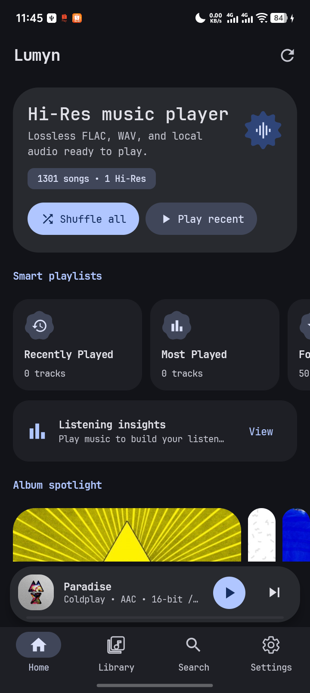
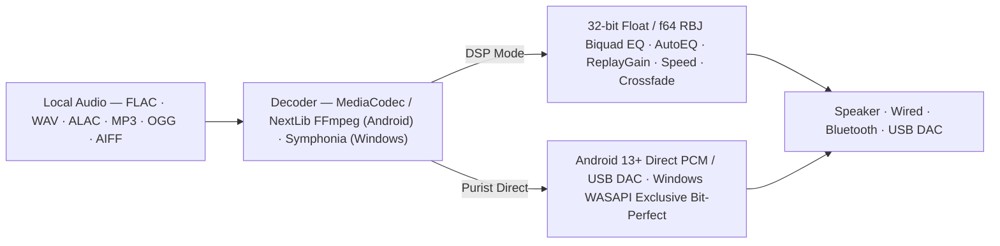

<div align="center">


# LUNARIA

**Offline Hi-Res music player for Android & Windows * built for people who own their music.**

[**Website (`lunarias.vercel.app`)**](https://lunarias.vercel.app) · [**Download Releases**](https://github.com/Dawnistrator/Lunaria/releases) · [**Windows Blueprint**](docs/WINDOWS_BLUEPRINT.md)

[](https://lunarias.vercel.app)
[](https://github.com/Dawnistrator/Lunaria/releases)
[-3DDC84?style=flat-square&logo=android&logoColor=white)](https://developer.android.com)
[](desktop/README.md)
[](desktop/Cargo.toml)
[](https://kotlinlang.org)
[](#5-privacy-by-architecture)
[](LICENSE)

No accounts, no cloud sync, and zero network telemetry. Just your FLAC, WAV, ALAC, and MP3 files, a transparent floating-point audio engine, and tactile **Lunar Indigo** interfaces that stay out of your way.

</div>

---

## Screenshots

<div align="center">
<table>
  <tr>
    <td align="center" valign="top" width="25%">
      <br />
      <sub><b>Home &amp; Mini-Player</b></sub>
    </td>
    <td align="center" valign="top" width="25%">
      <br />
      <sub><b>Now Playing &amp; Seekbar</b></sub>
    </td>
    <td align="center" valign="top" width="25%">
      <br />
      <sub><b>Library &amp; Artists</b></sub>
    </td>
    <td align="center" valign="top" width="25%">
      <br />
      <sub><b>Equalizer &amp; 32-bit DSP</b></sub>
    </td>
  </tr>
</table>
</div>

---

## Download

Grab signed installers and packages from [**GitHub Releases**](https://github.com/Dawnistrator/Lunaria/releases) or the [**Lunaria Download Center**](https://lunarias.vercel.app/#download), and verify every download against the attached `SHA256SUMS.txt`.

### Windows 10 / 11 (`x86_64`)

| File | Description |
| :--- | :--- |
| `Lunaria-v*-windows-x64-setup.exe` | Per-user NSIS Installer into `%LOCALAPPDATA%\Programs\Lunaria` (no UAC elevation, Start Menu & audio associations) |
| `Lunaria-v*-windows-x64-portable.zip` | Zero-install portable package (`lunaria.exe` + `portable.flag`, stores data locally in `./data/`) |

### Android (`8.0+`)

| File | Recommended For |
| :--- | :--- |
| `Lunaria-v*-arm64-v8a.apk` | Most modern Android phones (Android 8.0+ 64-bit ARM — smallest download) |
| `Lunaria-v*-universal.apk` | Any Android device if you are unsure of your CPU architecture |
| `Lunaria-v*-armeabi-v7a.apk` | Older 32-bit ARM devices |
| `Lunaria-v*-x86_64.apk` / `Lunaria-v*-x86.apk` | Emulators and x86/x86_64 ChromeOS devices |

---

## What Makes Lunaria Different

### 1. Honest Hi-Res Audio Pipeline
Instead of slapping "Hi-Res" badges on mystery audio routing, both Android and Windows expose the real stage-by-stage path inside **Audio Signal Path**:



- **Float DSP Pipeline:** End-to-end 32-bit float (`LunariaAudioProcessorChain` on Android) and 64-bit internal / 32-bit float I/O (`lunaria-dsp` on Windows) featuring real-time 10-band RBJ biquad EQ + live Bode curve, parametric AutoEQ `.txt` import, ReplayGain/R128 headroom, L/R balance, mono downmix, soft limiter, pitch-preserving playback speed (`0.5x`–`2.0x`), and equal-power cosine crossfade.
- **Bit-Perfect Hardware Output:** Supports Direct PCM / USB DAC exclusive routing on Android 13+/14+ and **WASAPI Exclusive** on Windows (`24-in-32` container negotiation) with automatic pause on DAC disconnect.
- **Format Coverage:** Platform codecs + bundled **NextLib FFmpeg (`1.11.1-0.19.0`)** on Android and pure-Rust **Symphonia** on Windows for FLAC, WAV, ALAC, AAC, MP3, OGG Vorbis, AIFF, APE, WavPack, and WMA.

### 2. Tactile Craft & Lunar Indigo Identity
- **Concept B Monogram & Lunar Indigo (`#32428A`):** Unified visual identity across Android, Windows Desktop, and Web (`#0D101B` night / `#F5F7FC` light baselines — documented in [`website/DESIGN.md`](website/DESIGN.md)).
- **Dynamic Artwork Theme (HCT):** Mathematically aligned Material 3 color extraction from the active album cover on both Android (`AlbumArtColorScheme`) and Windows (`mcu-material-color` via `LunariaTheme`).
- **Studio Controls & Typography:** Bundled offline **JetBrains Mono** everywhere, smooth marquee track titles, wavy seekbars, live 20 Hz–20 kHz EQ frequency plot, and an optional **Zero-VRAM Software Renderer** on Windows.

### 3. Built for Real Local Libraries
- **Safe In-File Tag & Cover Editor:** Streaming Kotlin writer (`FLAC`, `MP3`, `MP4/M4A` via Android 11+ `MediaStore.createWriteRequest`) and `lofty` atomic writer on Windows with **File-Lock Handover** so currently playing tracks can be edited cleanly without Windows file-lock errors.
- **Instant Offline Search & Cue Splitting:** SQLite `FTS5` instant search, virtual `.cue` track splitting, synced `.lrc` / embedded lyrics with tap-to-seek, drag-to-reorder persistent queues, M3U/M3U8 import/export, folder whitelist/blacklist filters, local Smart Playlists, and Listening Stats.
- **Android Form Factors:** Adaptive layouts for phones, foldables, and tablets, plus a Glance home screen widget (`lunaria_widget_info.xml`) and Android Auto (`MediaLibraryService`).

### 4. Native Windows Shell & Automatic Discord Rich Presence
- **Full OS Integration (`lunaria-win`):** Windows SMTC Media Flyout & Lock Screen artwork/controls, System Tray (`Close to Tray` with `0 Hz` UI idle redraw), Taskbar `ITaskbarList3` preview buttons & progress bar, Explorer `WM_DROPFILES` drag-and-drop, and Single-Instance Named Pipe forwarding.
- **Automatic Discord Rich Presence:** Enabled by default with a one-click **Discord RPC: On / Off** toggle in Settings. Connects strictly via local Windows Named Pipes (`\\.\pipe\discord-ipc-0..9`) to show active Track Title, Artist, and `Codec • Bitrate • Sample Rate` (`PLAY`/`PAUSE` sync with zero HTTP/network libraries).

### 5. Privacy by Architecture
Lunaria operates 100% locally on both platforms and can be audited independently from every release build:

```bash
# Android: verify zero INTERNET / ACCESS_NETWORK_STATE permissions in compiled APK
aapt2 dump permissions app/build/outputs/apk/release/app-arm64-v8a-release.apk
```

```powershell
# Windows: verify zero HTTP / TLS / socket crates in the Rust dependency graph (0 matches)
cargo tree --workspace --edges normal | Select-String -Pattern "reqwest|hyper|tokio|curl|ureq|surf|isahc|rustls|native-tls|openssl|h2|quinn|tungstenite"
```

---

## Repository & Architecture

| Directory | Scope | Details |
| :--- | :--- | :--- |
| [`app/`](app), [`core/`](core), [`feature/`](feature) | **Android App** (`com.lunaria.music`) | 12-module Jetpack Compose Material 3 Expressive + Media3 player |
| [`desktop/`](desktop/README.md) | **Windows Desktop** (`lunaria-desktop`) | 8-crate Pure Rust (`edition = "2024"`) + Slint `1.19.1` + WASAPI workspace |
| [`website/`](website/package.json) | **Web Overview** (`lunarias.vercel.app`) | Bilingual (`EN`/`ID`) Next.js `16.4` + React `19` + Tailwind `4` landing page |
| [`docs/`](docs/WINDOWS_BLUEPRINT.md) | **Docs & Brand** | Desktop architecture blueprint, screenshots, and Discord PNG assets |

<details>
<summary>Android 12-Module & Desktop Workspace Breakdown</summary>

| Android Module | Responsibility |
| :--- | :--- |
| `:app` | Adaptive shell (`LunariaApp`), Navigation, Glance widget, Android Auto entry |
| `:core:model` | Pure Kotlin domain models, ReplayGain math, AutoEQ/LRC/M3U/CUE parsers, Smart Playlist rules |
| `:core:designsystem` | Bundled JetBrains Mono typography, `MaterialExpressiveTheme`, HCT color extraction, icons |
| `:core:database` | Room database (`lunaria.db`, `v3`), DAOs, DataStore (`lunaria_prefs`) & persisted queue |
| `:core:media-scanner` | MediaStore scanner/observer, header & ReplayGain parser, in-file tag writer, lyrics loader |
| `:core:audio-engine` | `LunariaPlaybackService`, `LunariaAudioProcessorChain`, `LunariaDspAudioProcessor`, RBJ DSP, crossfade, USB DAC routing |
| `:feature:*` | `home`, `library`, `player`, `search`, `equalizer`, `settings` UI screens & view models |

| Desktop Crate (`desktop/`) | Responsibility |
| :--- | :--- |
| `lunaria-model` | Pure domain models, parsers (AutoEQ, CUE, LRC, M3U), ReplayGain, Smart Playlists (`zero I/O`) |
| `lunaria-dsp` | Lock-free `f64` RBJ biquad 10-band EQ, AutoEQ, balance, mono, limiter, cosine crossfade |
| `lunaria-audio` | `symphonia` decoders, `rtrb` ring buffer, `rubato` resampler, WSOLA speed, WASAPI Shared & Exclusive |
| `lunaria-scanner` | Parallel `rayon` indexer, `notify` watcher, `blake3` artwork cache, HCT seed extraction |
| `lunaria-tags` | `lofty` tag/cover writer with Windows File-Lock Handover Protocol |
| `lunaria-db` | Bundled SQLite WAL + FTS5 instant search, queue persistence, Portable Mode |
| `lunaria-win` | Pure Win32/WinRT SMTC, System Tray, `ITaskbarList3`, Single-Instance Pipe, `WM_DROPFILES`, Discord IPC |
| `lunaria-desktop` | Slint `1.19.1` UI shell (`#32428A` Lunar Indigo), controller, Bode plot & tray lifecycle |

</details>

---

## Tech Stack

- **Android:** `minSdk = 26`, `compileSdk = 37`, `targetSdk = 36` · AGP `9.1.1` · Gradle `9.3.1` · Kotlin `2.4.21` · Jetpack Compose (`BOM 2026.11.01`, Material 3 `1.5.0`, Adaptive `1.2.0`) · Media3 `1.11.1` · NextLib FFmpeg `1.11.1-0.19.0` · Room `2.8.5` · Hilt `2.60.1` · Coil `3.4.0` · Glance `1.2.0`
- **Windows Desktop:** Rust (`edition = "2024"`, MSRV `1.99`) · Slint `1.19.1` (`FemtoVG` + `Software` fallback) · `wasapi` + `windows` Win32/WinRT · `symphonia` · `rubato` · `rusqlite` (`bundled`) · `lofty` · `mcu-material-color` · NSIS installer
- **Website:** Next.js `16.4` · React `19` · TypeScript `5.8` · Tailwind CSS `4` · `@phosphor-icons/react`

---

## Building, Testing & Releases

### Android
```bash
# Debug build & unit tests
./gradlew assembleDebug testDebugUnitTest :core:model:test

# Signed split + universal release APKs (requires local keystore.properties or LUNARIA_KEYSTORE_* env vars)
./gradlew assembleRelease

# Signed Play Store App Bundle
./gradlew bundleRelease
```

Copy [`keystore.properties.example`](keystore.properties.example) to `keystore.properties` (gitignored) for local release signing, or configure `LUNARIA_KEYSTORE_BASE64`, `LUNARIA_KEYSTORE_PASSWORD`, `LUNARIA_KEY_ALIAS`, and `LUNARIA_KEY_PASSWORD` for automated GitHub Actions builds via [`.github/workflows/release.yml`](.github/workflows/release.yml) (`v*` tags).

### Windows Desktop
Run from [`desktop/`](desktop/README.md):
```powershell
$env:CARGO_BUILD_WARNINGS = "deny"
cargo fmt --all --check
cargo clippy --workspace --all-targets
cargo test --workspace
cargo bench -p lunaria-dsp -- --test
cargo build --release -p lunaria-desktop
```

Tagging a commit with `win-*` (for example `win-0.1.0`) triggers [`.github/workflows/release-windows.yml`](.github/workflows/release-windows.yml) to build and publish `Lunaria-v*-windows-x64-setup.exe` ([`lunaria-installer.nsi`](desktop/packaging/windows/lunaria-installer.nsi)), `Lunaria-v*-windows-x64-portable.zip`, and `SHA256SUMS.txt`.

### Website
Run from `website/`:
```bash
npm run lint
npm run build
```

---

## License

Lunaria (Android, Windows Desktop, Website, and workspace crates) is licensed under the **GNU General Public License v3.0 (`GPL-3.0-only`)** — see [`LICENSE`](LICENSE) for full terms.
