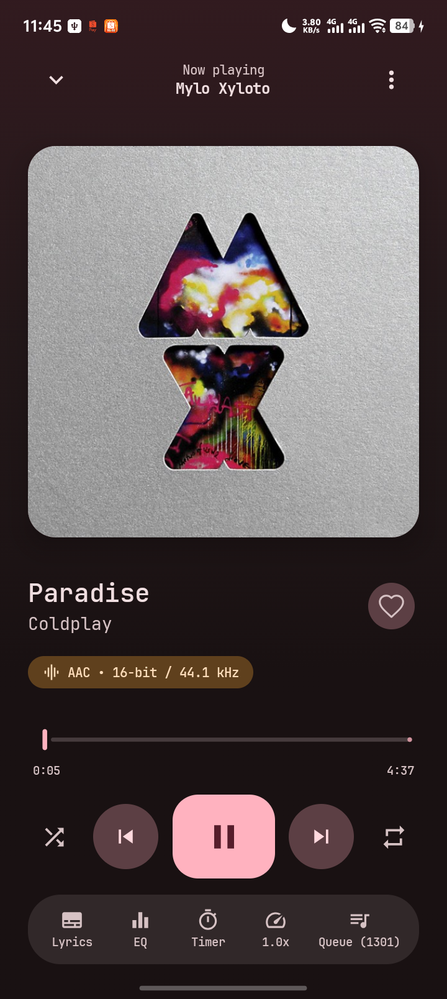
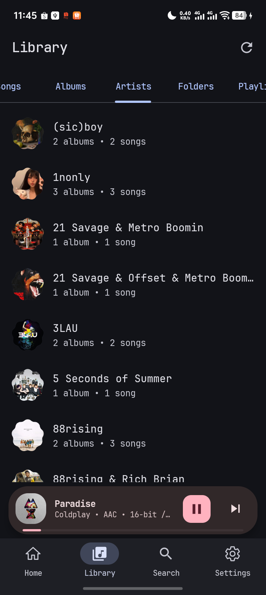
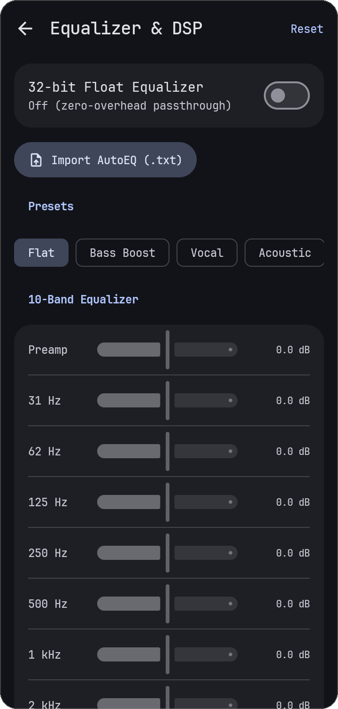
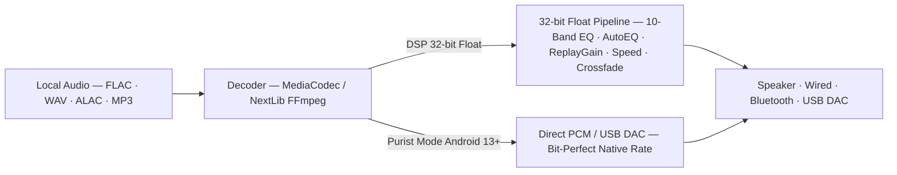

<div align="center">

# LUNARIA

**A local Hi-Res music player for Androi * built for people who own their music.**

[](https://github.com/Dawnistrator/Lunaria/releases/latest)
[-3DDC84?style=flat-square&logo=android&logoColor=white)](https://developer.android.com)
[](https://kotlinlang.org)
[](https://m3.material.io)
[](https://developer.android.com/media/media3)
[-111111?style=flat-square)](#privacy-by-architecture)
[](LICENSE)

No accounts, no cloud sync, and zero network permissions. Just your FLAC, WAV, ALAC, and MP3 files, a transparent 32-bit float audio engine, and a tactile Material 3 Expressive interface that stays out of the way.

</div>

---

## Screenshots

<div align="center">
<table>
  <tr>
    <td align="center" valign="top" width="25%">
      <br />
      <sub><b>Home &amp; Mini-Player</b></sub>
    </td>
    <td align="center" valign="top" width="25%">
      <br />
      <sub><b>Now Playing &amp; Seekbar</b></sub>
    </td>
    <td align="center" valign="top" width="25%">
      <br />
      <sub><b>Library &amp; Artists</b></sub>
    </td>
    <td align="center" valign="top" width="25%">
      <br />
      <sub><b>Equalizer &amp; 32-bit DSP</b></sub>
    </td>
  </tr>
</table>
</div>

---

## Download

Grab signed release APKs directly from [**GitHub Releases**](https://github.com/Dawnistrator/Lunaria/releases/latest):

| File | Recommended For |
| :--- | :--- |
| `Lunaria-v*-arm64-v8a.apk` | Most modern Android phones (Android 8.0+ 64-bit ARM — smallest download) |
| `Lunaria-v*-universal.apk` | Any Android device if you are unsure of your CPU architecture |
| `Lunaria-v*-armeabi-v7a.apk` | Older 32-bit ARM devices |
| `Lunaria-v*-x86_64.apk` / `Lunaria-v*-x86.apk` | Emulators and x86/x86_64 ChromeOS devices |

You can verify integrity against the attached `SHA256SUMS.txt` on every release.

---

## What Makes Lunaria Different

### 1. Honest Hi-Res Audio Pipeline
Instead of slapping "Hi-Res" badges on mystery audio routing, Lunaria exposes the exact chain from file to output inside an interactive **Audio Signal Path** sheet:



- **DSP 32-bit Float Mode:** End-to-end 32-bit float `AudioProcessorChain` featuring real-time 10-band RBJ biquad graphic EQ and presets, AutoEQ parametric `.txt` import, seekable ReplayGain (`REPLAYGAIN_*` & `R128_*` even past large embedded artwork), L/R channel balance, mono downmix, soft limiter, variable playback speed (`0.5x`–`2.0x`), and speed-aware equal-power crossfade.
- **Direct PCM (Android 13+) & Bit-Perfect USB DAC (Android 14+):** Bypasses the system mixer and hands native sample rate and bit depth directly to your USB-C DAC—plus automatic pause if you unplug it.
- **Format Coverage:** Platform codecs plus bundled **NextLib FFmpeg (`1.11.1-0.19.0`)** so FLAC works smoothly down to Android 8.0 Oreo alongside ALAC, APE, WavPack, and WMA.

### 2. Material 3 Expressive Craft
- Built on **Material 3 `1.5.0` (`Compose BOM 2026.11.01`)** with `MaterialExpressiveTheme`, spring-driven `MotionScheme.expressive()`, and bundled offline **JetBrains Mono** typography across regular and emphasized scales.
- **Adaptive Artwork Now Playing:** Dynamic color extraction samples the active album cover for both the full player and the floating pill mini-player. Includes a custom wavy `Canvas` audio seekbar while playing, smooth marquee titles, a symmetrical Audio Signal Path + Favorite action row, and morphing play/pause controls.
- **Tactile Visual Accents:** `MaterialShapes` (`SoftBurst`, `Cookie7Sided`, `Cookie9Sided`), wavy progress indicators during scans and listening breakdowns, connected `ToggleButton` groups, and responsive layouts across phones, foldables, and tablets.

### 3. Built for Real Local Libraries
- **In-File Tag & Cover Editor:** Streaming pure-Kotlin metadata writer for **FLAC** (`Vorbis Comment` + `PICTURE`), **MP3** (`ID3v2.3/v2.4` + `APIC`), and **MP4/M4A** (`ilst` + `stco`/`co64` offset shifting) with Android 11+ `MediaStore.createWriteRequest` consent.
- **Virtual `.cue` Splitting:** Play single-file album rips cleanly as individual clipped tracks via Media3 `ClippingConfiguration`.
- **Smart & Classic Playlists:** M3U8 import/export, synced `.lrc` & embedded lyrics with tap-to-seek, drag-to-reorder persistent queue, folder whitelist/blacklist filters, and local Smart Playlists (**Recently Played**, **Most Played**, **Forgotten Gems**, **Hi-Res Collection**, **Favorites**).
- **Everyday Extras:** On-device Listening Stats, Glance home screen widget, and Android Auto (`MediaLibraryService`) browse tree + playback resumption.

### Privacy by Architecture
Lunaria declares **zero `INTERNET` or `ACCESS_NETWORK_STATE` permissions** in both debug and release manifests. You can verify this directly on any compiled APK:

```bash
aapt2 dump permissions app/build/outputs/apk/release/app-arm64-v8a-release.apk
```

---

## Module Architecture

| Module | What it owns |
|---|---|
| `:app` | Adaptive shell (`LunariaApp`), Navigation, Glance widget, Android Auto entry |
| `:core:model` | Pure Kotlin domain models, ReplayGain math, AutoEQ/LRC/M3U/CUE parsers, Smart Playlist rules |
| `:core:designsystem` | Bundled JetBrains Mono typography, `MaterialExpressiveTheme`, color extraction, shared components & icons |
| `:core:database` | Room database (`v3` with `MIGRATION_2_3`), DAOs, DataStore preferences & persisted playback queue |
| `:core:media-scanner` | MediaStore scanner/observer, binary header & ReplayGain parser, in-file tag writer, lyrics loader |
| `:core:audio-engine` | `LunariaPlaybackService`, `LunariaAudioProcessorChain`, `LunariaDspConfigStore`, `LunariaDspAudioProcessor`, RBJ biquad DSP, 32-bit float `SonicAudioProcessor` playback speed, crossfade, USB DAC routing |
| `:feature:home` | Home hero card, Smart Playlists strip, Album Spotlight carousel, local Listening Stats |
| `:feature:library` | Songs, Albums, Artists, Folders, Playlists tabs + `LibraryDetailScreen` |
| `:feature:player` | Now Playing screen & supporting pane, floating mini-player, Queue, Signal Path, Lyrics & Tag Editor sheets |
| `:feature:search` | Instant offline search across tracks, albums, and artists |
| `:feature:equalizer` | 10-band EQ, built-in presets, AutoEQ `.txt` import, ReplayGain, L/R balance, mono, crossfade |
| `:feature:settings` | Theme mode, dynamic wallpaper color, folder filter manager, audio output mode & diagnostics |

---

## Tech Stack

- **SDK & Build:** `minSdk = 26` (Android 8.0 Oreo), `compileSdk = 37`, `targetSdk = 36` · AGP `9.1.1` · Gradle `9.3.1` · Kotlin `2.4.21` · JDK 17+
- **UI:** Jetpack Compose (`BOM 2026.11.01`, Material 3 `1.5.0`, Adaptive `1.2.0`), Coil `3.4.0`, Glance `1.2.0`
- **Audio & Storage:** Jetpack Media3 `1.11.1`, NextLib FFmpeg extension `1.11.1-0.19.0`, Room `2.8.5`, DataStore `1.3.0`, Hilt `2.60.1`

---

## Building & Testing

### Debug APK & Unit Tests
```bash
./gradlew assembleDebug testDebugUnitTest :core:model:test
```

### Release Signing Setup
Copy `keystore.properties.example` to `keystore.properties` (gitignored) and fill in your signing credentials:
```properties
storeFile=keystore/lunaria-release.jks
storePassword=YOUR_STORE_PASSWORD
keyAlias=lunaria
keyPassword=YOUR_KEY_PASSWORD
```
For CI builds without a local `keystore.properties`, set `LUNARIA_KEYSTORE_PATH`, `LUNARIA_KEYSTORE_PASSWORD`, `LUNARIA_KEY_ALIAS`, and `LUNARIA_KEY_PASSWORD` as environment variables.

### Release APKs & Play Store Bundle
```bash
# Signed per-ABI split APKs + universal APK under app/build/outputs/apk/release/
./gradlew assembleRelease

# Signed Play Store App Bundle under app/build/outputs/bundle/release/app-release.aab
./gradlew bundleRelease
```

### Automated GitHub Releases
[`.github/workflows/release.yml`](.github/workflows/release.yml) runs unit tests, builds & verifies signed release APKs (`apksigner verify` + `aapt2 dump permissions`), generates `SHA256SUMS.txt`, and publishes a GitHub Release automatically whenever you push a `v*` tag (or trigger **workflow_dispatch** from the Actions tab) with these four repository secrets configured:
- `LUNARIA_KEYSTORE_BASE64`
- `LUNARIA_KEYSTORE_PASSWORD`
- `LUNARIA_KEY_ALIAS`
- `LUNARIA_KEY_PASSWORD`

---

## Lunaria for Windows (`desktop/`)

Lunaria also ships a native **Windows 10/11 (`x86_64`)** desktop application under [`desktop/`](desktop/README.md) built in **100% Pure Rust (`edition = "2024"`, MSRV `1.99`)** + **Slint `1.19.1` (Material Design 3)** + **WASAPI Shared & Exclusive**:

- **Same Core Philosophy, Native Desktop Footprint:** Zero-network (`NET_MATCHES=0` verified via `cargo tree`), 64-bit RBJ biquad DSP + live Bode plot, honest **Audio Signal Path**, `.cue` virtual tracks, `lofty` tag/cover editor with Windows File-Lock Handover, bundled offline **JetBrains Mono**, and optional **Zero-VRAM Software Renderer**.
- **Native Windows Shell (`lunaria-win`) & Automatic Discord RPC:** SMTC media flyout & hardware media keys, System Tray (`Close to Tray`), Taskbar `ITaskbarList3` progress & thumbnail controls, Explorer `WM_DROPFILES` drag-and-drop, Single-Instance Named Pipe forwarding, and Discord Rich Presence (enabled by default with an On/Off toggle in Settings) over local Windows Named Pipes (`\\.\pipe\discord-ipc-0..9`).
- **Portable ZIP & NSIS Installer:** Builds a self-contained stripped executable (`Portable ZIP` via `portable.flag`) alongside [`desktop/packaging/windows/lunaria-installer.nsi`](desktop/packaging/windows/lunaria-installer.nsi) and [`.github/workflows/release-windows.yml`](.github/workflows/release-windows.yml) (`win-v*` tags).

See [`desktop/README.md`](desktop/README.md) and [`docs/WINDOWS_BLUEPRINT.md`](docs/WINDOWS_BLUEPRINT.md) for architecture details, keyboard shortcuts, and build commands.

---

## License

Lunaria (Android, Windows Desktop, and supporting workspace crates) is licensed under the **GNU General Public License v3.0 (`GPL-3.0-only`)** — see [`LICENSE`](LICENSE) for full terms.
