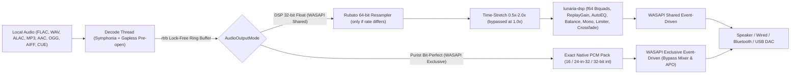

# Lunaria for Windows — Architectural Blueprint

> **Status:** M0–M6 Implementation Complete & Verified (Release-Ready)  
> **Stack:** 100% Pure Rust (`edition = "2024"`, MSRV `1.99`) · **Slint `1.19` (Material Design 3)** · **WASAPI Shared & Exclusive**  
> **Target OS:** Windows 10 / Windows 11 (`x86_64`)

---

## 1. Executive Summary & Core Principles

**Lunaria for Windows** is a 100% offline Hi-Res local music player built with philosophical parity, acoustic precision, and visual design parity alongside **Lunaria Android (`v1.0.0`)**, engineered from scratch in native Rust and Slint for minimal CPU, GPU, and RAM footprint while playing in the background during work or gaming.

### Architectural Principles
- **100% Offline & Zero-Network Core:** No accounts, analytics, HTTP auto-updaters, or outbound network libraries. Zero-network architecture is verified automatically in CI via `cargo tree` audits ensuring zero HTTP/TLS/socket crates appear in the workspace dependency graph (`NET_MATCHES=0`).
- **Honest Hi-Res Audio Signal Path:** The **Audio Signal Path** panel reports the actual live signal chain honestly in real time (source codec, decoder, resampler if active, DSP stages, WASAPI Shared vs Exclusive mode, and hardware output bit depth & sample rate). Bluetooth A2DP is never mislabeled as bit-perfect.
- **Tactile Studio Craft (Material 3 Expressive):** Preserves Lunaria's studio aesthetic from [website/DESIGN.md](../website/DESIGN.md) and [AlbumArtColorScheme.kt](../core/designsystem/src/main/kotlin/com/lunaria/core/designsystem/theme/AlbumArtColorScheme.kt) — Lunar Indigo dark baseline (`#0D101B`), brand seed `#32428A`, light mode (`#F5F7FC`), dynamic HCT color extraction from album artwork, bundled offline **JetBrains Mono** typography (100% parity with Android `LunariaTypography.kt`), wavy seekbar, and real-time EQ frequency response plot.
- **UI-Agnostic Core:** Domain models, DSP, audio engine, scanner, tag writer, SQLite storage, and Windows OS integrations live in standalone library crates inside `desktop/crates/`, decoupled cleanly from the `desktop/apps/lunaria-desktop/` shell.

### Resource Budget Targets
| Application State | Target RAM | Target CPU | Target GPU / VRAM |
| :--- | :--- | :--- | :--- |
| **Window open, playing 24-bit/96 kHz FLAC + 10-band EQ** | `~15–35 MB` | `< 1.0%` | `< 1%` (`0 VRAM` in Software mode) |
| **Paused / Idle (window open)** | `~15–30 MB` | `~0%` (event-driven) | `0%` (zero redraw loop) |
| **Minimized to System Tray (audio playing)** | `~12–20 MB` | `< 0.5%` (audio thread only) | `0%` (UI rendering completely paused) |

> [!NOTE]
> **Slint & Project Licensing (`GPL-3.0-only`):**  
> This project is licensed under the **GNU General Public License v3.0 (`GPL-3.0-only`)**, matching [`LICENSE`](../LICENSE) at the repository root and `license = "GPL-3.0-only"` across every Rust crate in `desktop/Cargo.toml`, aligned with Slint (`slint` `1.19.1`) open-source licensing.

---

## 2. Monorepo & Cargo Workspace Layout (`desktop/`)

Windows desktop development sits in `desktop/` alongside the Android modules (`app/`, `core/`, `feature/`) and landing page (`website/`).

```text
Lunaria/
├── app/, core/, feature/            # Android App (v1.0.0)
├── website/                         # Bilingual Next.js Landing Page
├── docs/
│   └── WINDOWS_BLUEPRINT.md         # This blueprint document
└── desktop/                         # Lunaria for Windows (Cargo Workspace)
    ├── Cargo.toml                   # Virtual workspace (resolver = "3", edition = "2024")
    ├── Cargo.lock
    ├── crates/
    │   ├── lunaria-model/           # Pure domain types, ReplayGain, AutoEQ, CUE, LRC, M3U, Smart Playlists (zero I/O)
    │   ├── lunaria-dsp/             # 64-bit internal / 32-bit float I/O RBJ Biquads, limiter, balance, mono, crossfade
    │   ├── lunaria-audio/           # Symphonia decoders, rtrb gapless ring buffer, Rubato, WASAPI Shared/Exclusive
    │   ├── lunaria-scanner/         # walkdir + rayon indexer, notify watcher, blake3 artwork cache, HCT extractor
    │   ├── lunaria-tags/            # Lofty in-file tag & cover writer + Windows File-Lock Handover Protocol
    │   ├── lunaria-db/              # rusqlite (bundled WAL + FTS5) Room v3 parity + Portable Mode (portable.flag)
    │   └── lunaria-win/             # SMTC, System Tray, ITaskbarList3, single-instance, file drop, Discord IPC
    └── apps/
        └── lunaria-desktop/         # Slint 1.19 desktop shell
            ├── Cargo.toml
            ├── build.rs             # slint_build::CompilerConfiguration (@material library path & Windows .rc)
            ├── assets/              # Bundled offline fonts (JetBrains Mono), icon SVG, lunaria.ico/.rc
            ├── third_party/         # Vendored Slint ui-libraries/material (offline & reproducible)
            ├── src/                 # App controller, view models, Slint adapters, adaptive frame pacing
            └── ui/                  # Material Design 3 .slint components & screens
```

### 1-to-1 Android → Windows Parity Map

| Android Module | Windows Rust Crate | Primary Responsibilities |
| :--- | :--- | :--- |
| `:core:model` | `lunaria-model` | `Track`, `AudioSpec`, `EqualizerSettings`, `AutoEqParser`, `CueSheetParser`, `CueVirtualTracks`, `LrcParser`, `M3uPlaylistParser`, `ReplayGainCalculator`, `SmartPlaylistEngine`, `FolderFilterConfig`, `PlaybackState`, `AudioSignalPath` |
| `:core:audio-engine` *(DSP)* | `lunaria-dsp` | Precision numerical port of [BiquadDspEngine.kt](../core/audio-engine/src/main/kotlin/com/lunaria/core/audioengine/BiquadDspEngine.kt) and [CrossfadeCurve.kt](../core/audio-engine/src/main/kotlin/com/lunaria/core/audioengine/CrossfadeCurve.kt) |
| `:core:audio-engine` *(Playback)* | `lunaria-audio` | Decoding (`symphonia`), gapless pre-buffer (`rtrb`), resampling (`rubato`), playback speed `0.5x–2.0x`, WASAPI Shared & Exclusive, `IMMNotificationClient` hot-plug, [AudioSignalPathBuilder.kt](../core/audio-engine/src/main/kotlin/com/lunaria/core/audioengine/AudioSignalPathBuilder.kt) |
| `:core:media-scanner` *(Scan & Tags)* | `lunaria-scanner` + `lunaria-tags` | Multi-core parallel scan, live file watcher, artwork cache, LRC/embedded lyrics, safe Windows tag & cover writing |
| `:core:database` | `lunaria-db` | SQLite WAL + FTS5 instant search, preferences, persisted queue (`MAX_PERSISTED_QUEUE_SIZE = 2_000`), play history |
| `:core:designsystem` | `lunaria-scanner` *(HCT)* + `lunaria-desktop/ui` | Material 3 palettes via `mcu-material-color`, Slint `@material` widgets, M3 Expressive typography & shapes |
| `:app` + `:feature:*` | `lunaria-win` + `lunaria-desktop` | Adaptive desktop shell, Home, Library, Search, Now Playing, Queue, Lyrics, Signal Path, EQ, Tag Editor, Stats, Settings, Windows OS shell & Discord RPC |

### `desktop/Cargo.toml` Virtual Workspace Structure

Follows strict Rust workspace hygiene (`proj-workspace-large`, `proj-workspace-deps`, `proj-msrv-declare`, `lint-workspace-lints`, `lint-clippy-groups`, and `perf-release-profile`):

```toml
[workspace]
resolver = "3"
members = [
    "crates/lunaria-model",
    "crates/lunaria-dsp",
    "crates/lunaria-audio",
    "crates/lunaria-scanner",
    "crates/lunaria-tags",
    "crates/lunaria-db",
    "crates/lunaria-win",
    "apps/lunaria-desktop",
]

[workspace.package]
version = "1.0.0"
edition = "2024"
rust-version = "1.99"
license = "GPL-3.0-only"

[workspace.dependencies]
lunaria-model = { path = "crates/lunaria-model" }
lunaria-dsp = { path = "crates/lunaria-dsp" }
lunaria-audio = { path = "crates/lunaria-audio" }
lunaria-scanner = { path = "crates/lunaria-scanner" }
lunaria-tags = { path = "crates/lunaria-tags" }
lunaria-db = { path = "crates/lunaria-db" }
lunaria-win = { path = "crates/lunaria-win" }
# Error handling, serialization, audio/DSP, scanning, tags, Windows Win32/WinRT, Slint 1.19.1

[workspace.lints.rust]
unsafe_code = "deny"
missing_debug_implementations = "warn"
unused_results = "warn"
unused_qualifications = "warn"

[workspace.lints.clippy]
correctness = { level = "deny", priority = -1 }
suspicious = { level = "deny", priority = -1 }
style = { level = "warn", priority = -1 }
complexity = { level = "warn", priority = -1 }
perf = { level = "warn", priority = -1 }
unwrap_used = "deny"
expect_used = "warn"
panic = "deny"
dbg_macro = "warn"
print_stdout = "warn"
todo = "warn"
needless_pass_by_value = "warn"
redundant_closure_for_method_calls = "warn"
semicolon_if_nothing_returned = "warn"
undocumented_unsafe_blocks = "warn"

[profile.dev.package."*"]
opt-level = 3

[profile.release]
opt-level = 3
lto = "fat"
codegen-units = 1
panic = "abort"
strip = true
```

> [!NOTE]
> Workspace crates inherit `[lints] workspace = true`. Only `crates/lunaria-audio` (WASAPI COM calls) and `crates/lunaria-win` (Win32/WinRT shell FFI) permit `unsafe_code = "warn"` with sound safe abstractions and mandatory `// SAFETY:` documentation; `discord_rpc.rs` and `lunaria-model` contain zero `unsafe` code.

---

## 3. Slint + Material Design 3 Expressive UI Architecture

### Renderer Strategy (`-gnu` Local Toolchain & `-msvc` CI)
- **Active Renderers in `Cargo.toml`:**
  - `backend-default` + **`renderer-femtovg`** (lightweight OpenGL acceleration, default, compiles cleanly on both MinGW `-gnu` and MSVC `-msvc`).
  - **`renderer-software`** (pure CPU **0 VRAM** rendering for heavy gaming or problematic GPU drivers).
  - `accessibility` (Windows UI Automation / screen reader support).
- **Avoided in `-gnu`:** `renderer-skia` is excluded so MinGW-w64 builds remain fast and free of C++ Skia toolchain friction.
- **Runtime Switching:** Users can toggle between GPU FemtoVG (`winit-femtovg`) and Zero-VRAM Software (`winit-software`) from **Settings** (or via `$env:SLINT_BACKEND="winit-software"`).

### Official Slint Material 3 + Dynamic Album-Art HCT Theme
1. **Vendored Slint M3 Components:** Uses the official Slint Material Design 3 library (`ui-libraries/material`, [material.slint.dev](https://material.slint.dev/)) vendored in `desktop/apps/lunaria-desktop/third_party/material/` for 100% offline reproducible builds and registered via `slint_build::CompilerConfiguration`.
2. **Rust HCT Color Engine (`mcu-material-color`):** Uses `Hct`, `QuantizerCelebi`, `Score`, and `SchemeTonalSpot` to generate palettes **mathematically aligned** with [AlbumArtColorScheme.kt](../core/designsystem/src/main/kotlin/com/lunaria/core/designsystem/theme/AlbumArtColorScheme.kt):
   - Default seed fallback: `#32428A` (`LUNARIA_BRAND_SEED_ARGB` / `LunariaBrandSeedArgb`).
   - Dark baseline: background `#0D101B`, surface `#141827`, raised `#1C2236`, text `#F4F6FC` / `#B8C0D9` / `#96A0BF`, accent `#9AB0FF`.
   - Light baseline: background `#F5F7FC`, surface `#FFFFFF`, raised `#E8ECF7`, text `#0E1224` / `#373F5C` / `#4D5675`, accent `#2A3B85`.
3. **Dynamic Slint Theme Bridge:**
   - Exposes `export global LunariaTheme` in `.slint` with full Material 3 color tokens (`primary`, `on-primary`, `primary-container`, `on-primary-container`, `secondary`, `surface`, `surface-container-lowest..highest`, `on-surface`, `on-surface-variant`, `outline`, `outline-variant`, and `is-dark`).
   - Rust updates `ui.global::<LunariaTheme>()` on track changes and theme switches with smooth `280ms` (`cubic-bezier(0.22, 1, 0.36, 1)`) transitions.

### M3 Expressive Visuals, Typography & Adaptive Frame Pacing
- **Bundled Offline Typography:**
  - **100% JetBrains Mono** (`Regular 400`, `Medium 500`, `SemiBold 600`, `Bold 700`) embedded globally across UI and tabular telemetry metrics, matching [LunariaTypography.kt](../core/designsystem/src/main/kotlin/com/lunaria/core/designsystem/theme/LunariaTypography.kt) on Android without relying on system fonts.
- **Resizable Studio Window:** `1180×724` default size (`1080×700` minimum) so the navigation rail, workspace, and supporting pane stay balanced across window sizes.
- **Custom M3 Expressive Widgets:**
  - **Wavy Audio Seekbar:** Rendered with Slint `Path` animating a sine wave during active playback and flattening cleanly when paused.
  - **Live EQ Bode Curve:** Renders the combined 20 Hz–20 kHz logarithmic frequency response directly from `lunaria_dsp::compute_magnitude_response_db(freq_hz)`.
  - **Tactile Shapes & Morphing:** `SoftBurst` / `Cookie` SVG paths, Play/Pause `border-radius` morphing, connected toggle chips, and fixed-stretch marquee titles.
- **Adaptive Frame Pacing & Background Lifecycle:**
  - Playhead timer (`30 Hz` / `33 ms`) runs only when `window_visible && is_playing`.
  - When minimized to **System Tray** while audio plays, the controller switches to a lightweight **1000 ms** tick without touching Slint UI properties (`0 Hz` redraws) to maintain queue advancement, play history, sleep timer, SMTC, tray tooltips, and Discord RPC sync. When paused or stopped, the timer stops (`0 Hz`).
  - Large libraries (`50,000+` tracks) render lazily through virtualized Slint `ListView` models backed by `Rc<dyn slint::Model<Data = TrackRow>>`.

---

## 4. Real-Time Windows Audio Pipeline (`lunaria-dsp` & `lunaria-audio`)



### 4-Thread Model & Real-Time Invariants
1. **UI / Main Thread (Slint Event Loop):** Sends transport commands (`Play`, `Pause`, `Seek`, `SwitchDevice`, `SwitchMode`) over bounded `crossbeam-channel`s and consumes lock-free telemetry snapshots (`ArcSwap`).
2. **Decode & Mix Thread:**
   - Decodes containers via `symphonia`, honoring `.cue` virtual bounds (`clip_start_ms` / `clip_end_ms`).
   - **Pre-opens the next track decoder** ahead of EOF for **sample-accurate gapless transitions** when formats match.
   - Runs dual-deck equal-power cosine crossfade (`0–12` seconds) matching [CrossfadeCurve.kt](../core/audio-engine/src/main/kotlin/com/lunaria/core/audioengine/CrossfadeCurve.kt).
   - Feeds PCM frames into a **lock-free SPSC ring buffer (`rtrb`)**.
3. **WASAPI Render Thread (`lunaria-audio`):**
   - **Strict Real-Time Invariant:** Zero heap allocations, zero mutex/RwLock contention, zero panics, and zero logging inside the audio callback loop.
   - Reads EQ, preamp, ReplayGain, balance, and mono updates **lock-free** via `ArcSwap<DspConfigSnapshot>` + `AtomicU64` (`Acquire`/`Release`), mirroring [LunariaDspConfigStore](../core/audio-engine/src/main/kotlin/com/lunaria/core/audioengine/LunariaDspAudioProcessor.kt#L30-L81).
   - Executes **`f64`** internal double-precision RBJ biquads with **`f32`** I/O matching [BiquadDspEngine.kt](../core/audio-engine/src/main/kotlin/com/lunaria/core/audioengine/BiquadDspEngine.kt):
     - 10-band graphic EQ (`31, 62, 125, 250, 500, 1000, 2000, 4000, 8000, 16000 Hz`, `Q = 1.41`).
     - Parametric AutoEQ filters (`PEAKING`, `LOW_SHELF`, `HIGH_SHELF`).
     - ReplayGain Track/Album + `R128` offset (`+5.0 dB`) + preamp (`[-24, +24] dB`) + peak clipping guard.
     - L/R channel balance, mono downmix, and soft limiter (`tanh` above threshold `0.95`).
4. **Background Worker Pool (`rayon` + Dedicated SQLite Thread):** Parallel directory indexing, `blake3` artwork caching, HCT seed calculation, and atomic disk tag updates.

### WASAPI Exclusive Format Negotiation (Purist Mode) & Hot-Plug
1. When `AudioOutputMode::PuristDirectBitPerfect` is active on a non-Bluetooth endpoint:
   - Probe order via `IAudioClient::IsFormatSupported(AUDCLNT_SHAREMODE_EXCLUSIVE, ...)`:
     1. Native sample rate + **24-bit valid in 32-bit container** (`WAVEFORMATEXTENSIBLE`: `wBitsPerSample = 32, wValidBitsPerSample = 24`) for 24-bit sources.
     2. Native sample rate + **24-bit packed** (`wBitsPerSample = 24`).
     3. Native sample rate + **32-bit int** (`wBitsPerSample = 32`) or **16-bit int** (`wBitsPerSample = 16`).
     4. Lossless zero-padded fallback (`16/24-bit` in `32-bit int`) at the exact native sample rate.
2. **Bluetooth A2DP** sinks or devices rejecting Exclusive mode fall back honestly to WASAPI Shared Mode and display the active stage & fallback reason in **Audio Signal Path**.
3. **USB DAC Hot-Plug (`IMMNotificationClient`):** When a DAC disconnects or `AUDCLNT_E_DEVICE_INVALIDATED` occurs, the render thread exits cleanly, triggers **auto-pause**, releases COM handles, re-enumerates endpoints, and updates Signal Path without hangs.

---

## 5. Database, Parallel Scanner, Tag Writer & Portable Mode

### SQLite WAL + FTS5 (`lunaria-db`)
Powered by bundled SQLite via `rusqlite` (`PRAGMA journal_mode = WAL; PRAGMA synchronous = NORMAL; PRAGMA foreign_keys = ON;`):

| Table / Virtual Table | Schema & Parity Role (Android Room v3 Parity) |
| :--- | :--- |
| `tracks` | Full column parity with [TrackEntity.kt](../core/database/src/main/kotlin/com/lunaria/core/database/entity/TrackEntity.kt) (`id`, `title`, `artist`, `album`, `album_artist`, `duration_ms`, `track_number`, `disc_number`, `year`, `genre`, `codec`, `bit_depth`, `sample_rate_hz`, `bitrate_kbps`, `channel_count`, `is_lossless`, `is_favorite`, `replay_gain_*`, `clip_start_ms`, `clip_end_ms`, `cue_source_path`, `play_count`, `last_played_at_ms`, `total_play_duration_ms`) plus desktop fields (`file_path`, `file_size`, `modified_ns`, `artwork_hash`, `seed_color_argb`) |
| `tracks_fts` | `FTS5` virtual table indexing `title`, `artist`, `album`, `album_artist`, `genre`, and `file_name` with automatic triggers for `< 5 ms` Instant Search |
| `playlists` & `playlist_tracks` | Parity with [PlaylistEntity.kt](../core/database/src/main/kotlin/com/lunaria/core/database/entity/PlaylistEntity.kt) (`ON DELETE CASCADE`, `position` for drag-reorder) + `.m3u8` import/export |
| `watched_folders` | User music roots (default: `%USERPROFILE%\Music`) + whitelist/blacklist rules ([FolderFilter.kt](../core/model/src/main/kotlin/com/lunaria/core/model/FolderFilter.kt)) |
| `persisted_queue` | Last active queue (`<= 2_000` tracks per `MAX_PERSISTED_QUEUE_SIZE`), `current_index`, `position_ms`, `repeat_mode`, `shuffle_enabled`, `speed` |
| `app_preferences` | `theme_mode`, `use_album_art_theme`, `audio_output_mode`, `preferred_device_id`, `eq_settings_json`, `use_software_renderer`, `minimize_to_tray`, `discord_rpc_enabled` |

### Storage Paths & Portable Mode
- **Standard Installer Mode:**
  - Database & config: `%APPDATA%\Lunaria\lunaria.db`
  - Artwork cache (`blake3`-deduplicated thumbnails) & rotating local logs: `%LOCALAPPDATA%\Lunaria\artwork-cache\` and `%LOCALAPPDATA%\Lunaria\logs\`
- **Portable Mode (ZIP):**
  - When an empty `portable.flag` sits beside `lunaria.exe`, all database, cache, and log files live locally under `./data/` (`lunaria.db`, `artwork-cache/`, `logs/`), leaving Windows Registry and AppData untouched.

### Parallel Scanner & Live Watcher (`lunaria-scanner`)
- **Incremental Scan (`walkdir` + `rayon`):** Compares `(normalized_path, file_size, modified_ns)` against SQLite and skips unchanged files without re-opening audio headers or decoding covers.
- **Artwork Deduplication & Seed Caching:** Hashes covers with `blake3`, caches once, and precomputes `seed_color_argb` via `mcu-material-color` at scan time so Now Playing theme transitions stay `< 1 ms`.
- **Live Watcher (`notify`):** Monitors filesystem changes (`ReadDirectoryChangesW`) with `500 ms` debouncing to update the library automatically.

### Safe Windows Tag Editing Protocol (`lunaria-tags`)
On Windows, files held open by `symphonia` cannot be overwritten in place (`ERROR_SHARING_VIOLATION` / OS error 32). The handover protocol resolves this safely:
1. `lunaria-tags` checks with `lunaria-audio` whether `target_path` is open in the active decoder or gapless pre-open slot.
2. If open, `lunaria-audio` snapshots the exact playback cursor, briefly suspends playback, and **closes the OS file handle**.
3. `lunaria-tags` writes tags (`lofty`: FLAC, MP3, MP4/M4A, OGG, WAV, AIFF) to a temporary file in the same directory and performs an atomic replacement.
4. `lunaria-audio` re-opens the updated file, seeks sample-accurately back to the saved timestamp, resumes playback, and updates SQLite + `tracks_fts`.

---

## 6. Windows OS Integration (`lunaria-win`) & Desktop Layout

### Native Windows 10/11 Integration
- **SMTC (`SystemMediaTransportControls`):** Runs on a dedicated isolated STA thread wired to the Windows Media Flyout & Lock Screen (title, artist, album, cover art with stale-image `ClearAll()`, and hardware media keys `Play`, `Pause`, `Next`, `Previous`, `Stop`).
- **Taskbar Thumbnail Toolbar (`ITaskbarList3`):** Embeds `Previous`, `Play/Pause`, and `Next` controls plus a live taskbar progress bar, with automatic `TaskbarButtonCreated` recovery if Windows Explorer restarts.
- **System Tray (`Shell_NotifyIconW`):** Left-click toggles show/hide; right-click opens quick controls (`Show / Hide`, active track summary, `Play/Pause`, `Previous`, `Next`, `Quit`); optional *Minimize to tray on close* (`0 Hz` idle redraw).
- **Single-Instance & Explorer File Associations:** Named Windows Mutex & Named Pipe (`\\.\pipe\LunariaDesktopV1_Pipe`) plus `WM_DROPFILES` drag-and-drop let double-clicked audio/playlist files (`.flac`, `.wav`, `.alac`, `.mp3`, `.m4a`, `.aac`, `.ogg`, `.aiff`, `.aif`, `.cue`, `.m3u8`) open directly inside the running Lunaria window.
- **Automatic Discord Rich Presence (`discord_rpc.rs`):** Enabled by default with an **On / Off** toggle in **Settings**. Connects strictly over local Windows Named Pipes (`\\.\pipe\discord-ipc-0..9`) using Lunaria's built-in Application ID (`1575841247564791828`, optional `LUNARIA_DISCORD_CLIENT_ID` override) with zero HTTP/network dependencies (`NET_MATCHES=0`), showing **Title**, **Artist**, and **`Codec • Bitrate • Sample Rate`**.

### Desktop Layout & Keyboard Shortcuts
```text
┌───────────────────┬──────────────────────────────────────────────┬─────────────────────────┐
│ Navigation Rail   │ Main Workspace                               │ Supporting Pane         │
│ (Collapsible)     │                                              │ (Collapsible / Tabs)    │
│                   │  • Home (Resume, Smart Playlists, Spotlight) │                         │
│ • Home            │  • Library (Songs, Albums, Artists, Folders, │  [Now Playing]          │
│ • Library         │             Playlists — virtualized ListView)│  [Queue (move reorder)] │
│ • Search (Ctrl+K) │  • Equalizer (10-band, AutoEQ .txt, Bode)    │  [Lyrics (.lrc / tag)]  │
│ • Equalizer       │  • Listening Stats (100% local)              │  [Signal Path]          │
│ • Stats           │  • Settings (Audio, Folders, Theme, Renderer)│                         │
│ • Settings        │                                              │                         │
├───────────────────┴──────────────────────────────────────────────┴─────────────────────────┤
│ Persistent Transport Bar: [Cover + Title + ♡]  [⏮ ⏯ ⏭ Wavy Seekbar]  [WASAPI EXC 24/96] 🔊│
└──────────────────────────────────────────────────────────────────────────────────────────┘
```

| Shortcut | Action |
| :--- | :--- |
| `Space` | Play / Pause (when not typing in a text input) |
| `←` / `→` | Seek `-5s` / `+5s` |
| `↑` / `↓` | Volume `+5%` / `-5%` |
| `Ctrl+O` | Open local audio file(s) |
| `Ctrl+K` | Open / focus Instant Search |
| `Ctrl+L` | Open Synced Lyrics tab in Supporting Pane |
| `Ctrl+E` | Open Equalizer & DSP |
| `Ctrl+Q` | Open Queue tab in Supporting Pane |
| `Ctrl+I` | Open Audio Signal Path tab |
| `F` | Toggle Favorite on active track |
| `M` | Mute / Unmute |
| `Ctrl+Left` / `Ctrl+Right` | Previous / Next track |
| `Esc` | Close Tag Editor modal |

---

## 7. Rust Quality Standards & Mitigating 5 Windows Pitfalls

### Workspace Coding Rules
| Category & Rule ID | Concrete Enforcement in Lunaria Workspace |
| :--- | :--- |
| `proj-workspace-large`, `proj-workspace-deps`, `proj-msrv-declare` | Virtual workspace in `desktop/Cargo.toml`, shared `[workspace.dependencies]`, `rust-version = "1.99"`, `resolver = "3"`, `edition = "2024"` |
| `lint-workspace-lints`, `lint-clippy-groups`, `lint-build-warnings`, `lint-expect-over-allow` | `correctness`/`suspicious = deny`, `unwrap_used = deny`, `CARGO_BUILD_WARNINGS = deny` in CI, `#[expect(..., reason = "...")]` when justified |
| `err-thiserror-lib`, `err-anyhow-app`, `err-no-unwrap-prod` | All `lunaria-*` library crates expose structured `thiserror` enums; only `lunaria-desktop` uses `anyhow`; zero `.unwrap()` or panics in production code |
| `unsafe-sound-abstractions`, `unsafe-minimize-scope`, `unsafe-safety-comment` | `unsafe_code` denied at workspace root; only `lunaria-audio` & `lunaria-win` allow `warn` for Win32/WASAPI FFI wrapped in safe interfaces with `// SAFETY:` blocks |
| `conc-atomic-ordering`, `conc-rayon-par-iter`, `mem-reuse-collections` | Lock-free DSP via `ArcSwap` + `AtomicU64` (`Acquire`/`Release`); parallel scanning via `rayon`; scratch buffer reuse in DSP loops |
| `type-newtype-ids`, `num-saturating-clamp`, `api-sans-io` | Strongly typed IDs (`TrackId(i64)`, `AlbumId(i64)`, `PlaylistId(i64)`); clamped EQ/speed/PCM math; `lunaria-model` contains zero I/O |
| `test-proptest-properties`, `test-criterion-bench`, `perf-release-profile` | `proptest` fuzzing for AutoEQ/LRC/CUE/ReplayGain parsers & biquad stability; `criterion` DSP benchmark (`96 kHz / 32f stereo < 1% CPU`); release `lto = "fat"`, `codegen-units = 1`, `panic = "abort"`, `strip = true` |

### 5 Critical Windows Pitfalls & Mitigations
1. **`ERROR_SHARING_VIOLATION` when Editing Active Track Tags:**  
   *Mitigation:* The File-Lock Handover Protocol (`lunaria-tags` ↔ `lunaria-audio`) closes the OS handle cleanly at the exact playback sample position, writes atomically via a temp file, and resumes playback seamlessly.
2. **24-bit `WAVEFORMATEXTENSIBLE` Negotiation on USB DACs:**  
   *Mitigation:* Most Windows WASAPI Exclusive USB DAC drivers reject 24-bit packed frames and expect **24-bit valid inside a 32-bit container** (`wBitsPerSample = 32, wValidBitsPerSample = 24`). `lunaria-audio` prioritizes this layout during format probing.
3. **`AUDCLNT_E_DEVICE_INVALIDATED` on DAC Unplug or Rate Switch:**  
   *Mitigation:* The render thread exits the WASAPI loop without panics or deadlocks, signals the controller to **auto-pause**, drops COM resources, and re-enumerates endpoints via `IMMNotificationClient`.
4. **Long Paths (`\\?\`), Unicode, Case-Insensitivity & Relative `.cue`/`.m3u8` Paths:**  
   *Mitigation:* Canonical path normalization handling `\\?\` prefixes, case-insensitive deduplication keys on Windows, and playlist-relative path resolution.
5. **Local `-gnu` MinGW Toolchain vs `-msvc` CI:**  
   *Mitigation:* Avoids `renderer-skia` and standardizes on **`renderer-femtovg` + `renderer-software`**, yielding identical UI rendering behavior across both toolchains.

---

## 8. Zero-Network Audit & Automated Release Pipeline (CI)

### Quality & Privacy Verification Commands
```powershell
# 1. Zero-Network Crate Audit (must return 0 matches)
cargo tree --workspace --edges normal | Select-String -Pattern "reqwest|hyper|tokio|curl|ureq|surf|isahc|rustls|native-tls|openssl|h2|quinn|tungstenite"

# 2. Strict Lint & Clippy Gate (zero warnings)
$env:CARGO_BUILD_WARNINGS = "deny"
cargo clippy --workspace --all-targets

# 3. Unit, Property-Based & Parity Tests
cargo test --workspace

# 4. DSP Performance Gate (< 1% CPU @ 96 kHz 32f stereo)
cargo bench -p lunaria-dsp -- --test
```

### GitHub Actions Workflow (`.github/workflows/release-windows.yml`)
Runs on `windows-latest` (`x86_64-pc-windows-msvc`) for `win-*` tags (e.g. `win-v1.0.0`) or manual `workflow_dispatch`, producing:
- `Lunaria-v*-windows-x64-setup.exe` (Per-user NSIS Installer with Start Menu shortcuts & audio file associations)
- `Lunaria-v*-windows-x64-portable.zip` (`lunaria.exe` + `LICENSE` + `portable.flag`)
- `SHA256SUMS.txt` for download integrity verification on GitHub Releases and [website/](../website).

---

## 9. Implementation Roadmap & Verification Summary (M0–M6 Complete)

All 6 implementation milestones plus the Lunar Indigo rebrand and Discord Rich Presence integration pass automated verification (`53` unit/parity/proptest workspace tests across all 8 crates, `cargo clippy --workspace --all-targets` with `CARGO_BUILD_WARNINGS=deny`, DSP benchmark `lunaria_dsp_96khz_stereo_1s_15_biquads`, and zero-network audit `NET_MATCHES=0`):

| Milestone & Status | Key Deliverables | Verified Results |
| :--- | :--- | :--- |
| **M0 — Workspace & Slint M3 PoC** `[DONE]` | `desktop/` workspace, strict workspace lints, vendored Slint M3 library, WASAPI PoC, bundled JetBrains Mono | `cargo clippy --workspace --all-targets` 0 warnings; resizable `1180×724` Slint M3 window |
| **M1 — `lunaria-model` & `lunaria-dsp`** `[DONE]` | Pure domain models, parsers (AutoEQ, ReplayGain/R128, CUE, LRC, M3U8, Smart Playlists, FolderFilter) & `BiquadDspEngine` + `CrossfadeCurve` | `8` `lunaria-model` + `8` `lunaria-dsp` unit/`proptest` tests pass; 96 kHz/32f DSP benchmark `< 1%` CPU |
| **M2 — `lunaria-audio` (WASAPI)** `[DONE]` | `symphonia` decoding, `rtrb` gapless ring buffer, `rubato` resampling, WSOLA `0.5x–2.0x` speed, crossfade, WASAPI Shared + Exclusive, hot-plug auto-pause, `AudioSignalPathBuilder` | `11` `lunaria-audio` tests pass (headless CI safe); `--probe-wasapi` enumerates endpoints safely from STA threads |
| **M3 — `lunaria-db`, `lunaria-scanner`, `lunaria-tags`** `[DONE]` | SQLite WAL + FTS5, parallel `rayon` scanner + `notify` watcher, `blake3` artwork cache + `mcu-material-color` HCT extractor, `lofty` atomic tag writer + File-Lock Handover, Portable Mode | `4` `lunaria-db` + `6` `lunaria-scanner` + `2` `lunaria-tags` tests pass; Portable Mode (`portable.flag` → `./data/lunaria.db`) verified |
| **M4 — Full Slint Material 3 Expressive UI** `[DONE]` | Home, Library (5 tabs, `LunariaScrollBar`), Instant Search (`Ctrl+K`), Now Playing + Dynamic Album Theme, Queue reorder, Synced Lyrics, Signal Path, EQ + live Bode curve, Tag Editor, Stats, Settings | `7` `lunaria-desktop` tests (including WCAG AA role contrast tests); GPU FemtoVG & Software Zero-VRAM renderers; `0 Hz` redraw when hidden |
| **M5 & M6 — `lunaria-win`, Discord RPC & Release** `[DONE]` | Pure Win32/WinRT `lunaria-win` (SMTC + `ClearAll()`, System Tray, `ITaskbarList3` + recovery, Single-Instance Named Pipe, `WM_DROPFILES`, local Named Pipe Discord Rich Presence), NSIS installer, CI `release-windows.yml`, `GPL-3.0-only` | `7` `lunaria-win` tests pass (including Discord RPC IPC frame codec); LTO release build (`lunaria-desktop.exe`), NSIS script, portable ZIP & `SHA256SUMS.txt` verified |
