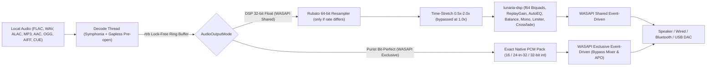

# Lunaria for Windows — Architectural Blueprint

> **Status:** Implementasi M0–M6 Selesai & Terverifikasi (Release-Ready)  
> **Stack:** 100% Pure Rust (`edition = "2024"`, MSRV `1.99`) · **Slint `1.19` (Material Design 3)** · **WASAPI Shared & Exclusive**  
> **Target OS:** Windows 10 / Windows 11 (`x86_64`)

---

## 1. Ringkasan Eksekutif & Prinsip Inti

**Lunaria for Windows** adalah pemutar musik lokal Hi-Res 100% offline untuk Windows yang dirancang dengan paritas filosofi, presisi akustik, dan bahasa desain **Lunaria Android (`v1.0.0`)**, tetapi dibangun dari nol secara native menggunakan Rust dan Slint agar sangat hemat CPU, GPU, dan RAM saat menemani kerja atau gaming di latar belakang.

### Prinsip Arsitektur
- **100% Offline & Zero-Network by Architecture:** Tidak ada akun, analitik, auto-updater HTTP, atau panggilan jaringan apa pun. Kepastian privasi diverifikasi otomatis di CI lewat pemeriksaan `cargo tree` bahwa tidak ada crate jaringan/HTTP/TLS di `Cargo.lock`.
- **Honest Hi-Res Audio Signal Path:** Panel **Audio Signal Path** menampilkan jalur sinyal aktual secara jujur dan real-time (codec sumber, decoder, resampler bila aktif, stage DSP, mode WASAPI Shared vs Exclusive, bit depth & sample rate output perangkat). Bluetooth A2DP tidak pernah diklaim bit-perfect.
- **Tactile Studio Craft (Material 3 Expressive):** Mempertahankan estetika audio studio Lunaria dari [website/DESIGN.md](../website/DESIGN.md) dan [AlbumArtColorScheme.kt](../core/designsystem/src/main/kotlin/com/lunaria/core/designsystem/theme/AlbumArtColorScheme.kt) — tema Lunar Indigo (`#0D101B`), seed `#32428A`, mode terang (`#F5F7FC`), ekstraksi warna HCT dinamis dari cover album, tipografi **JetBrains Mono** offline penuh (100% paritas Android `LunariaTypography.kt`), wavy seekbar, dan grafik respon frekuensi EQ real-time.
- **Core UI-Agnostic:** Seluruh domain model, DSP, audio engine, scanner, tag writer, database SQLite, dan integrasi OS Windows dipisahkan menjadi crate library murni di `desktop/crates/`, terpisah penuh dari shell UI `desktop/apps/lunaria-desktop/`.

### Target Anggaran Resource
| Kondisi Aplikasi | Target RAM | Target CPU | Target GPU / VRAM |
| :--- | :--- | :--- | :--- |
| **Window terbuka & memutar FLAC 24-bit/96 kHz + 10-band EQ** | `~15–35 MB` | `< 1.0%` | `< 1%` (`0 VRAM` pada mode Software) |
| **Paused / Idle (window terbuka)** | `~15–30 MB` | `~0%` (event-driven) | `0%` (0 redraw loop) |
| **Minimized ke System Tray (musik tetap berjalan)** | `~12–20 MB` | `< 0.5%` (thread audio saja) | `0%` (UI berhenti render total) |

> [!NOTE]
> **Status Lisensi Slint & Proyek (`GPL-3.0-only`):**  
> Proyek ini menggunakan **GNU General Public License v3.0 (`GPL-3.0-only`)** sebagaimana tercantum pada [`LICENSE`](../LICENSE) di root repositori serta field `license = "GPL-3.0-only"` pada workspace dan seluruh crate Rust (`desktop/Cargo.toml`), selaras penuh dengan pilihan lisensi open-source `GPL-3.0-only` dari Slint (`slint` `1.19.1`).

---

## 2. Monorepo & Tata Letak Cargo Workspace (`desktop/`)

Pengembangan Windows diletakkan di direktori `desktop/` sejajar dengan aplikasi Android (`app/`, `core/`, `feature/`) dan landing page (`website/`).

```text
Lunaria/
├── app/, core/, feature/            # Aplikasi Android (v1.0.0)
├── website/                         # Website bilingual Next.js
├── docs/
│   └── WINDOWS_BLUEPRINT.md         # Dokumen blueprint ini
└── desktop/                         # Lunaria for Windows (Cargo Workspace)
    ├── Cargo.toml                   # Virtual workspace (resolver = "3", edition = "2024")
    ├── Cargo.lock
    ├── crates/
    │   ├── lunaria-model/             # Pure domain types, ReplayGain, AutoEQ, CUE, LRC, M3U, Smart Playlists (zero I/O)
    │   ├── lunaria-dsp/               # 64-bit internal / 32-bit float I/O RBJ Biquads, limiter, balance, mono, crossfade
    │   ├── lunaria-audio/             # Symphonia decoders, rtrb gapless ring buffer, Rubato, WASAPI Shared/Exclusive
    │   ├── lunaria-scanner/           # walkdir + rayon indexer, notify watcher, blake3 artwork cache, HCT color extractor
    │   ├── lunaria-tags/              # Lofty in-file tag & cover writer + Windows File-Lock Handover Protocol
    │   ├── lunaria-db/                # rusqlite (bundled WAL + FTS5) parity Room v3 + Portable Mode (portable.flag)
    │   └── lunaria-win/               # SMTC, System Tray, ITaskbarList3 thumbnails, single-instance, file associations
    └── apps/
        └── lunaria-desktop/           # Slint 1.19 desktop shell
            ├── Cargo.toml
            ├── build.rs             # slint_build::CompilerConfiguration (@material library path)
            ├── assets/              # Bundled offline fonts (JetBrains Mono), icon SVG, app manifest
            ├── third_party/         # Vendored Slint ui-libraries/material (offline & reproducible)
            ├── src/                 # App controller, view models, Slint model adapters, frame pacing
            └── ui/                  # Komponen & layar .slint Material Design 3
```

### Pemetaan Paritas 1-ke-1 Android → Windows

| Modul Android | Crate Rust Windows | Tanggung Jawab Utama |
| :--- | :--- | :--- |
| `:core:model` | `lunaria-model` | `Track`, `AudioSpec`, `EqualizerSettings`, `AutoEqParser`, `CueSheetParser`, `CueVirtualTracks`, `LrcParser`, `M3uPlaylistParser`, `ReplayGainCalculator`, `SmartPlaylistEngine`, `FolderFilterConfig`, `PlaybackState`, `AudioSignalPath` |
| `:core:audio-engine` *(DSP)* | `lunaria-dsp` | Port numerik presisi dari [BiquadDspEngine.kt](../core/audio-engine/src/main/kotlin/com/lunaria/core/audioengine/BiquadDspEngine.kt) dan [CrossfadeCurve.kt](../core/audio-engine/src/main/kotlin/com/lunaria/core/audioengine/CrossfadeCurve.kt) |
| `:core:audio-engine` *(Playback)* | `lunaria-audio` | Decode (`symphonia`), gapless pre-buffer (`rtrb`), resampling (`rubato`), playback speed `0.5x–2.0x`, WASAPI Shared & Exclusive, `IMMNotificationClient` hot-plug, [AudioSignalPathBuilder.kt](../core/audio-engine/src/main/kotlin/com/lunaria/core/audioengine/AudioSignalPathBuilder.kt) |
| `:core:media-scanner` *(Scan & Tags)* | `lunaria-scanner` + `lunaria-tags` | Multi-core parallel scan, live file watcher, artwork cache, LRC/embedded lyrics, penulisan tag & cover art aman di Windows |
| `:core:database` | `lunaria-db` | SQLite WAL + FTS5 instant search, preferences, persisted queue (`MAX_PERSISTED_QUEUE_SIZE = 2_000`), play history |
| `:core:designsystem` | `lunaria-scanner` *(HCT)* + `lunaria-desktop/ui` | Material 3 palette via `mcu-material-color`, Slint `@material` widgets, tipografi & bentuk M3 Expressive |
| `:app` + `:feature:*` | `lunaria-win` + `lunaria-desktop` | Desktop adaptive shell, Home, Library, Search, Now Playing, Queue, Lyrics, Signal Path, EQ, Tag Editor, Stats, Settings, Windows OS shell integration |

### Kerangka `desktop/Cargo.toml` (Virtual Workspace)

Mengikuti standar `rust-skills`: `proj-workspace-large`, `proj-workspace-deps`, `proj-msrv-declare`, `lint-workspace-lints`, `lint-clippy-groups`, dan `perf-release-profile`.

```toml
[workspace]
resolver = "3"
members = [
    "crates/lunaria-model",
    "crates/lunaria-dsp",
    "crates/lunaria-audio",
    "crates/lunaria-scanner",
    "crates/lunaria-tags",
    "crates/lunaria-db",
    "crates/lunaria-win",
    "apps/lunaria-desktop",
]

[workspace.package]
version = "0.1.0"
edition = "2024"
rust-version = "1.99"
license = "GPL-3.0-only"

[workspace.dependencies]
# Internal crates
lunaria-model = { path = "crates/lunaria-model" }
lunaria-dsp = { path = "crates/lunaria-dsp" }
lunaria-audio = { path = "crates/lunaria-audio" }
lunaria-scanner = { path = "crates/lunaria-scanner" }
lunaria-tags = { path = "crates/lunaria-tags" }
lunaria-db = { path = "crates/lunaria-db" }
lunaria-win = { path = "crates/lunaria-win" }

# Error handling & observability
thiserror = "2"
anyhow = "1"
tracing = "0.1"
tracing-subscriber = { version = "0.3", features = ["env-filter"] }

# Concurrency, atomics & parallelism
arc-swap = "1"
crossbeam-channel = "0.5"
parking_lot = "0.12"
rayon = "1.10"
rtrb = "0.3"

# Audio & DSP
symphonia = { version = "0.5", features = ["all-codecs", "all-formats"] }
rubato = "0.16"
wasapi = "0.22"

# Data, storage, scanning & tags
rusqlite = { version = "0.37", features = ["bundled", "modern_sqlite"] }
serde = { version = "1", features = ["derive"] }
serde_json = "1"
walkdir = "2"
notify = "8"
lofty = "0.22"
blake3 = "1.8"
image = { version = "0.25", default-features = false, features = ["jpeg", "png", "webp", "bmp"] }
mcu-material-color = "0.2"

# Windows OS integration
windows = "0.61"
tray-icon = "0.21"
muda = "0.17"

# GUI (Slint 1.19 — configured without Skia for smooth -gnu and low footprint)
slint = { version = "1.19.1", default-features = false, features = [
    "std",
    "backend-winit",
    "renderer-femtovg",
    "renderer-software",
    "accessibility",
] }
slint-build = "1.19.1"

# Testing & benchmarks
proptest = "1.6"
criterion = "0.6"
tempfile = "3"

[workspace.lints.rust]
unsafe_code = "forbid"
missing_debug_implementations = "warn"
unused_results = "warn"
unused_qualifications = "warn"

[workspace.lints.clippy]
correctness = { level = "deny", priority = -1 }
suspicious = { level = "deny", priority = -1 }
style = { level = "warn", priority = -1 }
complexity = { level = "warn", priority = -1 }
perf = { level = "warn", priority = -1 }
unwrap_used = "deny"
expect_used = "warn"
panic = "deny"
dbg_macro = "warn"
print_stdout = "warn"
todo = "warn"
needless_pass_by_value = "warn"
redundant_closure_for_method_calls = "warn"
semicolon_if_nothing_returned = "warn"

[workspace.lints.cargo]
unused_dependencies = "warn"
unused_workspace_dependencies = "warn"

[workspace.lints.rustdoc]
broken_intra_doc_links = "deny"
private_intra_doc_links = "warn"

# Dev build tetap lancar memutar Hi-Res audio tanpa glitch
[profile.dev.package."*"]
opt-level = 3

[profile.release]
opt-level = 3
lto = "fat"
codegen-units = 1
panic = "abort"
strip = true
```

> [!NOTE]
> Hanya `crates/lunaria-audio/Cargo.toml` dan `crates/lunaria-win/Cargo.toml` yang boleh melakukan override `unsafe_code = "warn"` (karena FFI Windows WASAPI / Win32 COM), tetap tunduk pada aturan `unsafe-sound-abstractions`, `unsafe-minimize-scope`, `unsafe-safety-comment`, dan `doc-safety-section`. Setiap member crate wajib mewarisi `[lints] workspace = true`.

---

## 3. Arsitektur UI Slint + Material Design 3 Expressive

### Strategi Renderer (Toolchain Lokal `-gnu` & CI `-msvc`)
Berdasarkan pengecekan toolchain lokal:
- **Lokal PC:** `rustc 1.99.1` / `cargo 1.99.1`, default toolchain **`stable-x86_64-pc-windows-gnu`** (MinGW `gcc`/`g++`/`dlltool`/`lld`, `clang 23.1.3`, `cmake 4.4.4`; MSVC `cl.exe` belum terpasang).
- **Renderer aktif di `Cargo.toml`:**
  - `backend-winit` + **`renderer-femtovg`** (akselerasi OpenGL ringan, default, compile cepat & bersih di `-gnu`).
  - **`renderer-software`** (rendering CPU murni **0 VRAM**, ideal saat pengguna bermain game berat atau berada pada GPU driver bermasalah).
  - `accessibility` (dukungan Windows UI Automation / screen reader).
- **Dihindari di `-gnu`:** `renderer-skia` tidak diaktifkan secara default karena Skia berat dikompilasi dari source dan bermasalah di toolchain MinGW-w64.
- **Opsional WGPU/DX12:** Jika di masa depan dibutuhkan efek window translucent Windows 11 (*Mica/Acrylic*), fitur `renderer-femtovg-wgpu` harus memaksa Direct3D (`BackendSelector::require_d3d()` / `WGPU_BACKEND=dx12`) karena driver Vulkan Windows pada umumnya membatasi transparansi window.
- **Runtime Switching:** Pengguna dapat beralih antara mode GPU ringan (`winit-femtovg`) dan mode Zero-VRAM (`winit-software`) melalui Settings (atau env `SLINT_BACKEND=winit-software`).

### Official Slint Material 3 + Dynamic Album-Art HCT Theme
1. **Komponen M3 Resmi Slint:** Memanfaatkan library Material Design 3 resmi dari repositori utama Slint (`ui-libraries/material`, referensi [material.slint.dev](https://material.slint.dev/)). Direktori `ui-libraries/material` di-vendor ke `desktop/apps/lunaria-desktop/third_party/material/` agar build 100% reproducible & offline, lalu didaftarkan di `build.rs` via `slint_build::CompilerConfiguration::new().with_library_paths(...)`.
2. **Mesin Warna HCT Rust (`mcu-material-color`):** Menggunakan `Hct`, `QuantizerCelebi`, `Score`, dan `SchemeTonalSpot` agar ekstraksi warna sampul album menghasilkan palet yang **identik secara matematis** dengan [AlbumArtColorScheme.kt](../core/designsystem/src/main/kotlin/com/lunaria/core/designsystem/theme/AlbumArtColorScheme.kt).
   - Fallback seed default: `#32428A` (`LunariaBrandSeedArgb`).
   - Dark theme baseline: background `#0D101B`, surface `#141827`, raised surface `#1C2236`, teks `#F4F6FC` / `#B8C0D9` / `#96A0BF`, accent `#9AB0FF`.
   - Light theme baseline: background `#F5F7FC`, surface `#FFFFFF`, raised surface `#E8ECF7`, teks `#0E1224` / `#373F5C` / `#4D5675`, accent `#2A3B85`.
3. **Jembatan Tema Dinamis ke Slint:**
   - Mendefinisikan `export global LunariaTheme` di `.slint` berisi seluruh token warna Material 3 (`primary`, `on-primary`, `primary-container`, `on-primary-container`, `secondary`, `surface`, `surface-container-lowest..highest`, `on-surface`, `on-surface-variant`, `outline`, `outline-variant`, dll.) beserta `is-dark`.
   - Rust memperbarui properti `ui.global::<LunariaTheme>()` setiap kali lagu berganti atau mode tema berubah, dengan transisi warna halus `280ms` (`cubic-bezier(0.22, 1, 0.36, 1)`).

### Visual M3 Expressive, Tipografi & Adaptive Frame Pacing
- **Tipografi Offline Terpaket:**
  - **100% JetBrains Mono** (`Regular 400`, `Medium 500`, `SemiBold 600`, `Bold 700`) secara global di seluruh UI dan metrik audio/telemetry (`tabular-nums`), memberikan paritas penuh dengan [LunariaTypography.kt](../core/designsystem/src/main/kotlin/com/lunaria/core/designsystem/theme/LunariaTypography.kt) di Android tanpa bergantung font sistem Windows.
- **Resizable Studio Window:** Ukuran default `1180×724` (minimal `1080×700`) agar panel navigasi, workspace, dan Audio Signal Path tampil proporsional dan fleksibel di-resize.
- **Custom M3 Expressive Widgets:**
  - **Wavy Audio Seekbar:** Dirender menggunakan Slint `Path` (atau vector buffer ringan) dengan animasi gelombang sinus halus saat aktif memutar dan rata saat pause.
  - **Live EQ Bode Curve:** Menggambar kurva respon frekuensi gabungan (20 Hz–20 kHz, skala logaritmik) langsung dari `lunaria_dsp::compute_magnitude_response_db(freq_hz)`.
  - **Tactile Shapes & Morphing:** Bentuk emblem `SoftBurst` / `Cookie` sebagai SVG `Path`, tombol Play/Pause yang melakukan morphing `border-radius` (lingkaran ↔ rounded square), serta connected toggle buttons.
- **Adaptive Frame Pacing & Background Lifecycle:**
  - Timer update UI playhead (`30 Hz` / `33 ms`) aktif ketika `window_visible && is_playing`.
  - Saat window **Minimized ke System Tray** dan audio tetap memutar, controller menjalankan timer ringan **1000 ms** tanpa menyentuh properti visual Slint (`0 Hz` UI redraw) agar auto-advance antrean, pencatatan play history, sleep timer, SMTC, dan tooltip tray tetap berjalan. Saat lagu **Paused** / **Stopped**, timer berhenti penuh (`0 Hz`).
  - Daftar lagu besar (`50.000+` track) dirender lazy menggunakan Slint `ListView` yang terikat pada Rust `Rc<dyn slint::Model<Data = TrackRow>>`.

---

## 4. Real-Time Windows Audio Pipeline (`lunaria-dsp` & `lunaria-audio`)



### Model 4 Thread & Invarian Real-Time
1. **UI / Main Thread (Slint Event Loop):** Mengirim perintah transport (`Play`, `Pause`, `Seek`, `SwitchDevice`, `SwitchMode`) melalui bounded channel (`crossbeam-channel`) dan menerima state snapshot periodik (`15–30 Hz` untuk progress, event-driven untuk perpindahan track/Signal Path).
2. **Decode & Mix Thread:**
   - Membaca kontainer via `symphonia`, menghormati batas `clip_start_ms` / `clip_end_ms` pada track `.cue` virtual.
   - Melakukan **pre-open dekoder track berikutnya** beberapa detik sebelum track aktif selesai untuk **sample-accurate gapless playback** (jika format sample rate/channel sama).
   - Menangani dual-deck equal-power cosine crossfade (`0–12` detik) sesuai rumus di [CrossfadeCurve.kt](../core/audio-engine/src/main/kotlin/com/lunaria/core/audioengine/CrossfadeCurve.kt).
   - Mendorong sample ke **lock-free SPSC ring buffer (`rtrb`)**.
3. **WASAPI Render Thread (`lunaria-audio`):**
   - **Invarian Keras Real-Time:** **Zero heap allocation** (`Vec`/`String` forbidden), **zero mutex/RwLock**, **zero panic**, **zero logging** di dalam render loop.
   - Membaca pembaruan EQ, preamp, ReplayGain, balance, dan mono secara **lock-free** menggunakan `ArcSwap<DspConfigSnapshot>` + penghitung versi `AtomicU64` (`Ordering::Release` saat publish, `Ordering::Acquire` saat konsumsi) — mencerminkan desain [LunariaDspConfigStore](../core/audio-engine/src/main/kotlin/com/lunaria/core/audioengine/LunariaDspAudioProcessor.kt#L30-L81).
   - Menerapkan pemrosesan internal **`f64`** (double-precision biquads) dengan I/O **`f32`** (32-bit float) sesuai spesifikasi exact di [BiquadDspEngine.kt](../core/audio-engine/src/main/kotlin/com/lunaria/core/audioengine/BiquadDspEngine.kt):
     - 10-band graphic EQ (`31, 62, 125, 250, 500, 1000, 2000, 4000, 8000, 16000 Hz`, `Q = 1.41`).
     - Filter parametrik AutoEQ (`PEAKING`, `LOW_SHELF`, `HIGH_SHELF`).
     - ReplayGain Track/Album + offset `R128` (`+5.0 dB`) + preamp (`[-24, +24] dB`) + peak clipping prevention.
     - L/R channel balance, mono downmix, dan soft limiter (`tanh` di atas threshold `0.95`).
4. **Background Worker Pool (`rayon` + Dedicated SQLite Thread):** Parallel scanning folder, hashing & resize artwork, kalkulasi HCT seed color, dan penulisan tag ke disk.

### Negosiasi Format WASAPI Exclusive (Purist Mode) & Hot-Plug
1. Saat `AudioOutputMode::PuristDirectBitPerfect` aktif pada endpoint non-Bluetooth:
   - Urutan uji `IAudioClient::IsFormatSupported(AUDCLNT_SHAREMODE_EXCLUSIVE, ...)`:
     1. Native sample rate + **24-bit valid dalam container 32-bit** (`WAVEFORMATEXTENSIBLE`: `wBitsPerSample = 32, wValidBitsPerSample = 24`) untuk sumber 24-bit.
     2. Native sample rate + **24-bit packed** (`wBitsPerSample = 24`).
     3. Native sample rate + **32-bit int** (`wBitsPerSample = 32`) atau **16-bit int** (`wBitsPerSample = 16`).
     4. Fallback lossless: zero-padding 16/24-bit ke 32-bit int pada sample rate native yang sama (tetap bit-perfect secara matematis).
2. Jika device adalah **Bluetooth A2DP** atau endpoint menolak mode Exclusive (`AUDCLNT_E_UNSUPPORTED_FORMAT` / device in use): fallback jujur ke WASAPI Shared Mode dan tampilkan status serta alasannya di **Audio Signal Path**.
3. **USB DAC Hot-Plug (`IMMNotificationClient`):** Saat DAC dicabut atau stream mengembalikan `AUDCLNT_E_DEVICE_INVALIDATED`, audio thread langsung berhenti aman, mengirim event `DeviceDisconnected`, memicu **auto-pause**, dan memperbarui Signal Path tanpa hang atau crash.

---

## 5. Database, Parallel Scanner, Tag Writer & Portable Mode

### SQLite WAL + FTS5 (`lunaria-db`)
Menggunakan `rusqlite` dengan SQLite ter-bundle (`PRAGMA journal_mode = WAL; PRAGMA synchronous = NORMAL; PRAGMA foreign_keys = ON;`).

| Tabel / Virtual Table | Skema & Fungsi (Paritas Room v3) |
| :--- | :--- |
| `tracks` | Kolom penuh [TrackEntity.kt](../core/database/src/main/kotlin/com/lunaria/core/database/entity/TrackEntity.kt) (`id`, `title`, `artist`, `album`, `album_artist`, `duration_ms`, `track_number`, `disc_number`, `year`, `genre`, `codec`, `bit_depth`, `sample_rate_hz`, `bitrate_kbps`, `channel_count`, `is_lossless`, `is_favorite`, `replay_gain_*`, `clip_start_ms`, `clip_end_ms`, `cue_source_path`, `play_count`, `last_played_at_ms`, `total_play_duration_ms`) + kolom desktop (`file_path` unique normalized, `file_size`, `modified_ns`, `artwork_hash`, `seed_color_argb`) |
| `tracks_fts` | Virtual table `FTS5` terindeks pada `title`, `artist`, `album`, `album_artist`, `genre`, `file_name` dengan trigger sinkronisasi otomatis untuk search `< 5 ms` |
| `playlists` & `playlist_tracks` | Paritas [PlaylistEntity.kt](../core/database/src/main/kotlin/com/lunaria/core/database/entity/PlaylistEntity.kt) (`ON DELETE CASCADE`, `position` untuk urutan drag-reorder) + import/export `.m3u8` |
| `watched_folders` | Daftar root folder musik pilihan user (default: `%USERPROFILE%\Music`) + konfigurasi whitelist/blacklist ([FolderFilter.kt](../core/model/src/main/kotlin/com/lunaria/core/model/FolderFilter.kt)) |
| `persisted_queue` | State antrean terakhir (maks `2_000` track sesuai `MAX_PERSISTED_QUEUE_SIZE`), `current_index`, `position_ms`, `repeat_mode`, `shuffle_enabled`, `speed` |
| `app_preferences` | `theme_mode` (System/Light/Dark), `use_album_art_theme`, `audio_output_mode`, `preferred_device_id`, `eq_settings_json`, `use_software_renderer`, `minimize_to_tray` |

### Lokasi Penyimpanan Data & Portable Mode
- **Standard Installer Mode:**
  - Database & konfigurasi: `%APPDATA%\Lunaria\lunaria.db`
  - Cache artwork (resize thumbnail + original hash `blake3`) & log rotasi lokal: `%LOCALAPPDATA%\Lunaria\artwork-cache\` dan `%LOCALAPPDATA%\Lunaria\logs\`
- **Portable Mode (ZIP):**
  - Jika terdapat file `portable.flag` tepat di sebelah `lunaria.exe`, seluruh data disimpan relatif di `./data/` (`lunaria.db`, `artwork-cache/`, `logs/`). Tidak menulis registry maupun AppData.

### Parallel Scanner & Live Watcher (`lunaria-scanner`)
- **Incremental Scan (`walkdir` + `rayon`):** Membandingkan tuple `(normalized_path, file_size, modified_ns)` terhadap database; file yang tidak berubah dilewati tanpa membuka ulang header atau decode gambar.
- **Deduplikasi Artwork & Seed Color:** Cover album di-hash dengan `blake3`, disimpan satu kali di cache lokal, dan dihitung warna `seed_color_argb` via `mcu-material-color` sekali saat scan sehingga pergantian theme Now Playing berlangsung instan (`< 1 ms`).
- **Live Watcher (`notify`):** Memantau perubahan filesystem (`ReadDirectoryChangesW`) dengan debouncing `500 ms` agar penambahan/penghapusan file musik langsung tercermin di library.

### Protokol Aman Penulisan Tag Windows (`lunaria-tags`)
Di Windows, file yang masih dibuka oleh `File` handle `symphonia` tidak dapat ditimpa (`ERROR_SHARING_VIOLATION` / OS error 32). Protokol handover wajib dilakukan:
1. `lunaria-tags` meminta koordinasi ke `lunaria-audio` untuk memeriksa apakah `target_path` sedang dibuka oleh decoder aktif (atau pre-open gapless track berikutnya).
2. Jika sedang diputar: `lunaria-audio` menyimpan posisi sample eksak saat ini, melakukan pause singkat, dan **menutup handle file** secara eksplisit.
3. `lunaria-tags` menulis tag (`lofty`: FLAC, MP3, MP4/M4A, Ogg, WAV, AIFF) ke file sementara di direktori yang sama, lalu melakukan atomic replace ke file target.
4. `lunaria-audio` membuka ulang file yang baru ditulis, seek ke posisi sample yang tersimpan, dan melanjutkan playback sesuai status sebelumnya; database & `tracks_fts` ikut diperbarui.

---

## 6. Integrasi OS Windows (`lunaria-win`) & Tata Letak Desktop

### Integrasi Native Windows 10/11 (Pure `windows` Win32/WinRT)
- **SMTC (`SystemMediaTransportControls`):** Berjalan di thread STA terisolasi — terhubung ke Windows Media Flyout & Lock Screen (judul, artis, album, cover artwork dengan `ClearAll()` anti-stale, status play/pause) serta tombol media hardware (`Play`, `Pause`, `Next`, `Previous`, `Stop`).
- **Taskbar Thumbnail Toolbar (`ITaskbarList3`):** Tombol kontrol `Previous`, `Play/Pause`, `Next` & Taskbar progress bar langsung di jendela preview hover Taskbar Windows, lengkap dengan recovery otomatis pesan `TaskbarButtonCreated` saat Explorer restart.
- **System Tray (`Shell_NotifyIconW` Win32 murni):** Klik kiri toggle show/hide window, klik kanan menu cepat (`Show / Hide`, info *Now Playing*, `Play/Pause`, `Previous`, `Next`, `Quit`), plus opsi *Close button minimizes to tray* (`0 Hz` UI redraw saat tersembunyi).
- **Single-Instance & File Associations:** Menggunakan named Windows Mutex & Named Pipe (`\\.\pipe\LunariaDesktopV1_Pipe`) serta hook `WM_DROPFILES` sehingga klik ganda file audio/playlist di Windows Explorer (`.flac`, `.wav`, `.alac`, `.mp3`, `.m4a`, `.aac`, `.ogg`, `.aiff`, `.aif`, `.cue`, `.m3u8`) atau drag-and-drop langsung membuka & memutar track pada instance Lunaria yang berjalan.
- **Discord Rich Presence (`discord_rpc.rs`):** Aktif secara default dengan tombol **On / Off** di Settings, terhubung ke Discord Desktop melalui local Windows Named Pipe IPC (`\\.\pipe\discord-ipc-0..9`) memakai built-in Application ID resmi Lunaria tanpa crate jaringan/HTTP apa pun (`NET_MATCHES=0` tetap terjaga; mendukung override `LUNARIA_DISCORD_CLIENT_ID`).

### Tata Letak Desktop & Peta Pintasan Keyboard
```text
┌───────────────────┬──────────────────────────────────────────────┬─────────────────────────┐
│ Navigation Rail   │ Main Workspace                               │ Supporting Pane         │
│ (Collapsible)     │                                              │ (Collapsible / Tabs)    │
│                   │  • Home (Resume, Smart Playlists, Spotlight) │                         │
│ • Home            │  • Library (Songs, Albums, Artists, Folders, │  [Now Playing]          │
│ • Library         │             Playlists — virtualized ListView)│  [Queue (move reorder)] │
│ • Search (Ctrl+K) │  • Equalizer (10-band, AutoEQ .txt, Bode)    │  [Lyrics (.lrc / tag)]  │
│ • Equalizer       │  • Listening Stats (100% lokal)              │  [Signal Path]          │
│ • Stats           │  • Settings (Audio, Folders, Theme, Renderer)│                         │
│ • Settings        │                                              │                         │
├───────────────────┴──────────────────────────────────────────────┴─────────────────────────┤
│ Persistent Transport Bar: [Cover + Title + ♡]  [⏮ ⏯ ⏭ Wavy Seekbar]  [WASAPI EXC 24/96] 🔊│
└──────────────────────────────────────────────────────────────────────────────────────────┘
```

| Pintasan Keyboard | Aksi |
| :--- | :--- |
| `Space` | Play / Pause (saat fokus tidak di kotak input teks) |
| `←` / `→` | Seek `-5` detik / `+5` detik |
| `↑` / `↓` | Volume `+5%` / `-5%` |
| `Ctrl+O` | Buka file audio lokal |
| `Ctrl+K` | Buka / fokus Search instan (`FTS5`) |
| `Ctrl+L` | Buka tab Synced Lyrics di Supporting Pane |
| `Ctrl+E` | Buka layar Equalizer & DSP |
| `Ctrl+Q` | Buka tab Queue di Supporting Pane |
| `Ctrl+I` | Buka tab Audio Signal Path |
| `F` | Toggle Favorite pada track aktif |
| `M` | Mute / Unmute |
| `Ctrl+Left` / `Ctrl+Right` | Track sebelumnya / berikutnya |
| `Esc` | Tutup modal Tag Editor |

---

## 7. Standar `rust-skills` & Mitigasi 5 Pitfall Kritis Windows

### Penerapan Aturan `rust-skills`
| Kategori & Rule ID | Penerapan Konkret di Workspace Lunaria |
| :--- | :--- |
| `proj-workspace-large`, `proj-workspace-deps`, `proj-msrv-declare` | Virtual workspace di `desktop/Cargo.toml`, shared `[workspace.dependencies]`, `rust-version = "1.99"`, `resolver = "3"`, `edition = "2024"` |
| `lint-workspace-lints`, `lint-clippy-groups`, `lint-build-warnings`, `lint-expect-over-allow` | `correctness`/`suspicious = deny`, `unwrap_used = deny`, `CARGO_BUILD_WARNINGS = deny` di CI, gunakan `#[expect(..., reason = "...")]` bila ada pengecualian |
| `err-thiserror-lib`, `err-anyhow-app`, `err-no-unwrap-prod` | Semua crate `lunaria-*` mendefinisikan enum error terstruktur via `thiserror`; hanya `lunaria-desktop` memakai `anyhow`; nol `.unwrap()` di kode produksi |
| `unsafe-sound-abstractions`, `unsafe-minimize-scope`, `unsafe-safety-comment`, `doc-safety-section` | `unsafe_code = "forbid"` di workspace root; hanya `lunaria-audio` & `lunaria-win` (FFI Windows) diizinkan `warn` dengan abstraksi safe wrapper dan komentar `// SAFETY:` wajib |
| `conc-atomic-ordering`, `conc-rayon-par-iter`, `mem-reuse-collections`, `own-slice-over-vec` | Lock-free DSP via `ArcSwap` + `AtomicU64` (`Acquire`/`Release`); scan paralel via `rayon`; reuse buffer scratch di DSP; parameter `&[f32]`/`&str`/`&Path` |
| `type-newtype-ids`, `num-saturating-clamp`, `api-sans-io` | `TrackId(i64)`, `AlbumId(i64)`, `PlaylistId(i64)`; clamping aman pada gain EQ, speed, dan konversi PCM; `lunaria-model` murni tanpa I/O |
| `obs-tracing-over-log`, `obs-log-overhead` | Logging terstruktur via `tracing` (`tracing-subscriber` lokal file); nol alokasi/event logging di render thread audio |
| `test-proptest-properties`, `test-criterion-bench`, `perf-release-profile` | `proptest` untuk parser AutoEQ/LRC/CUE/ReplayGain & stabilitas biquad; `criterion` untuk benchmark DSP (`96 kHz / 32f stereo < 1% CPU`); release `lto = "fat"`, `codegen-units = 1`, `panic = "abort"`, `strip = true` |

### 5 Pitfall Kritis Khusus Windows & Mitigasinya
1. **`ERROR_SHARING_VIOLATION` saat Menulis Tag Track Aktif:**  
   *Mitigasi:* Protokol File-Lock Handover (`lunaria-tags` ↔ `lunaria-audio`) melepas file handle pada posisi sample eksak, menulis secara atomik via file sementara, lalu membuka ulang & seek sample-accurate.
2. **Negosiasi `WAVEFORMATEXTENSIBLE` 24-bit pada USB DAC Windows:**  
   *Mitigasi:* Mayoritas driver USB DAC WASAPI Exclusive di Windows menolak 24-bit packed (3 byte/sample) dan hanya menerima **24-bit valid dalam container 32-bit** (`wBitsPerSample = 32, wValidBitsPerSample = 24`). Urutan negosiasi format di `lunaria-audio` memprioritaskan format ini sebelum format lain.
3. **`AUDCLNT_E_DEVICE_INVALIDATED` saat USB DAC Dicabut / Ganti Sample Rate:**  
   *Mitigasi:* Render thread keluar bersih dari loop WASAPI tanpa panic/deadlock, memberi sinyal ke controller untuk **auto-pause**, melepas client COM, lalu melakukan re-enumerasi endpoint via `IMMNotificationClient` sebelum memperbarui Signal Path.
4. **Windows Long Paths (`\\?\`), Unicode, Case-Insensitivity & Path Relatif `.cue`/`.m3u8`:**  
   *Mitigasi:* Normalisasi path kanonik dengan penanganan prefix `\\?\`, perbandingan case-insensitive untuk deduplikasi path Windows, dan resolusi path relatif `.cue`/`.m3u8` berbasis direktori induk file playlist/cue.
5. **Toolchain Lokal `x86_64-pc-windows-gnu` vs CI `x86_64-pc-windows-msvc`:**  
   *Mitigasi:* Tidak bergantung pada `renderer-skia`; mengunci kombinasi **`renderer-femtovg` + `renderer-software`** agar kompilasi lokal dengan MinGW `-gnu` maupun rilis CI MSVC sama-sama mulus dan menghasilkan perilaku UI yang identik.

---

## 8. Audit Zero-Network & Pipeline Rilis Otomatis (CI)

### Verifikasi Kualitas & Privasi di Setiap PR / Tag Rilis
```powershell
# 1. Audit Zero-Network Crates (wajib keluar tanpa match!)
cargo tree --workspace --edges normal | Select-String -Pattern "reqwest|hyper|ureq|surf|isahc|rustls|native-tls|tokio-tungstenite|tungstenite"

# 2. Strict Lint & Clippy Gate (zero warnings)
$env:CARGO_BUILD_WARNINGS = "deny"
cargo clippy --workspace --all-targets

# 3. Unit, Property-Based & Parity Tests
cargo test --workspace

# 4. DSP Performance Gate (target < 1% CPU @ 96kHz 32f stereo)
cargo bench -p lunaria-dsp -- --test
```

### Workflow GitHub Actions (`.github/workflows/release-windows.yml`)
Berjalan pada runner `windows-latest` (`x86_64-pc-windows-msvc`) saat tag `win-v*` (atau `workflow_dispatch`), memproduksi artefak:
- `Lunaria-v*-windows-x64-setup.exe` (Installer NSIS dengan integrasi file association & Start Menu) dan/atau `.msi` (WiX)
- `Lunaria-v*-windows-x64-portable.zip` (berisi `lunaria.exe` + `portable.flag`)
- `SHA256SUMS.txt` untuk verifikasi integritas yang juga bisa diintegrasikan ke halaman download [website/](../website).

---

## 9. Roadmap Eksekusi & Status Verifikasi (Selesai M0–M6)

Seluruh 6 milestone implementasi beserta pengerasan rilis M6 telah selesai dan lolos verifikasi (`44` unit/parity/proptest workspace tests, `cargo clippy --workspace --all-targets` 0 warnings dengan `CARGO_BUILD_WARNINGS=deny`, benchmark DSP `lunaria_dsp_96khz_stereo_1s_15_biquads` Success, audit zero-network `NET_MATCHES=0`, release binary `22.38 MB` / portable ZIP `10.65 MB`, dan runtime idle **15.87 MB Private RAM** di mode Software Zero-VRAM):

| Milestone & Status | Deliverable Utama | Hasil Verifikasi Tercatat |
| :--- | :--- | :--- |
| **M0 — Workspace & Slint M3 PoC** `[DONE]` | Scaffold `desktop/` workspace + lints `rust-skills` + vendor Slint UI + WASAPI Shared PoC + JetBrains Mono | `cargo clippy --workspace --all-targets` 0 warning; jendela Slint M3 resizable `1180×724` tampil bersih |
| **M1 — `lunaria-model` & `lunaria-dsp`** `[DONE]` | 100% domain models, parsers (AutoEQ, ReplayGain/R128, CUE, LRC, M3U8, Smart Playlists, FolderFilter) & `BiquadDspEngine` + `CrossfadeCurve` | Unit tests + `proptest` lolos; benchmark DSP 96 kHz/32f stereo `< 1%` CPU |
| **M2 — `lunaria-audio` (WASAPI)** `[DONE]` | Decoder `symphonia` (FLAC/WAV/ALAC/MP3/AAC/OGG/AIFF), gapless `rtrb`, resampler `rubato`, speed `0.5x–2.0x`, crossfade, WASAPI Shared + Exclusive, hot-plug auto-pause, `AudioSignalPathBuilder` | Unit tests `lunaria-audio` lolos; `--probe-wasapi` mendeteksi endpoint WASAPI aktif tanpa konflik COM STA/MTA |
| **M3 — `lunaria-db`, `lunaria-scanner`, `lunaria-tags`** `[DONE]` | SQLite WAL + FTS5, parallel `rayon` scanner + `notify` watcher, `blake3` artwork cache + HCT seed color (`mcu-material-color`), tag/cover writer `lofty` + handover lock Windows, Portable Mode | `3` test `lunaria-db` + `4` test `lunaria-scanner` + `2` test `lunaria-tags` lolos; Portable Mode (`portable.flag` → `./data/lunaria.db`) terverifikasi E2E |
| **M4 — Full Slint Material 3 Expressive UI** `[DONE]` | Home, Library (5 tab, `LunariaScrollBar` terisi), Search (`Ctrl+K`), Now Playing + Dynamic Album Theme, Queue reorder, Synced Lyrics, Signal Path, EQ + live Bode curve + AutoEQ import, Tag Editor, Stats, Settings | `6` test `lunaria-desktop` lolos; dual-renderer FemtoVG (`161.21 MB` WS) & Software Zero-VRAM (`15.87 MB` Private / `49.96 MB` WS) berjalan mulus; `0 Hz` redraw saat hidden |
| **M5 & M6 — `lunaria-win`, Hardening & Release** `[DONE]` | Pure Win32/WinRT `lunaria-win` (SMTC + `ClearAll()`, System Tray, `ITaskbarList3` + `TaskbarButtonCreated` recovery, Single-Instance Named Pipe, `WM_DROPFILES`), pintasan `Ctrl+O`/`←→`/`↑↓`, NSIS installer, CI `release-windows.yml`, lisensi `GPL-3.0-only` | `4` test `lunaria-win` lolos; `--release` build & portable ZIP + `LICENSE` + `SHA256SUMS.txt` terverifikasi lengkap dan siap rilis publik |
